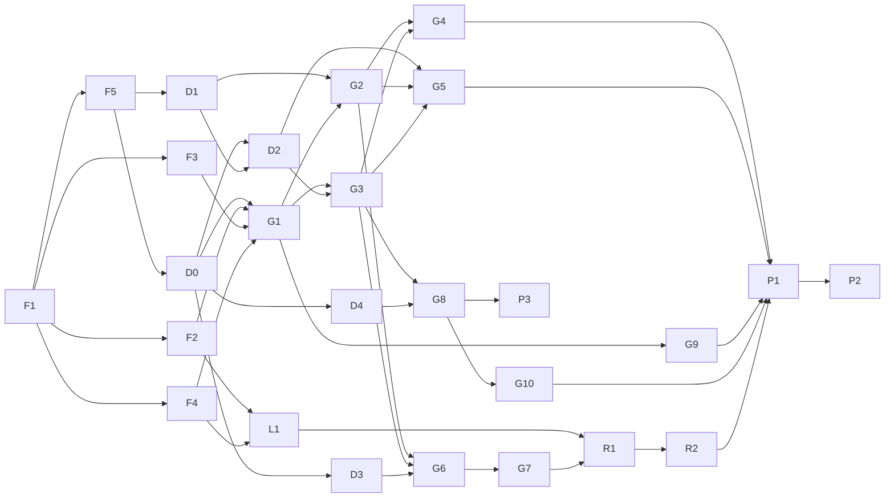

# Gameplay implementation plan – vertical slices

This document is the **main plan** for the implementation. `implementation-plan.md` is a historical document (the state of the foundations); the game rules are described in `cluedo-rules.md` (the "Implementation clarifications" section is binding).

Goal: a working online deduction game for 2–6 players following the rules in `cluedo-rules.md`, mobile first, responsive on desktop, light/dark theme, PL + EN interface, host-configurable turn time limit, "Play again" in the same room.

How to assign work to an agent: *"Implement slice `G3` from `docs/game-screens-plan.md`. First read the Architecture, Testing, and Definition of Done sections."* The agent works in a separate worktree/branch `slice/<ID>-<short-name>`, using TDD, and finally ticks `[x]` in its slice.

---

## 1. Baseline (audit)

Working: room creation/joining, character selection, player list, `room:start` (Playwright: 2 tests). `packages/game` has the board, cards, and turn logic with Vitest tests, but nothing is wired to the API or UI.

Gaps and problems the plan fixes:

| Area | Problem | Slice |
|---|---|---|
| API | `room:start` only sets `phase = IN_PROGRESS`, it does not call `startGame()` | G1 |
| Security | Identity = `playerName`; anyone who knows the code and name can play as someone else. The host is recognized by name in `LobbyScreen` | F2 |
| Rules | Eliminated players are skipped when disproving (they should keep disproving) | D3 |
| Rules | A player can pass while holding a matching card (disproving is mandatory) | D3 |
| Rules | Accusation only in the `ACTION` phase (should be possible at any moment of one's own turn, including after a suggestion) | D4 |
| Rules | Secret passage only after entering a room (should be used instead of rolling at the start of a turn) | D2 |
| Rules | Only the players' tokens are on the board (all 6 should be, including unused ones) | D0 |
| Rules | No "summoning to a room" – a player moved by someone else's suggestion can suggest without moving | D3 |
| Rules | A turn can get stuck in `MOVE` (no reachable cells, and `endTurn` requires `DONE`/`ACTION`) | D2 |
| Rules | Turn order is arbitrary (should start with the red character, then clockwise) | D0 |
| Board | No walls or board center, doors accessible from every side, a token in a room stored as a door cell | D1 |
| DRY | `characterIds` duplicated in `contracts`; `shuffle` and `Envelope` duplicated in `cards.ts`/`turn.ts`/`types.ts`; `reachableCells` scans the board instead of using `ROOM_DOORS`; the same turn validations repeated in every function | F1, D0 |
| Errors | The domain returns strings, the server sends English messages – they cannot be translated | F1 |
| Tests | No API and web tests, no lint configuration (although `turbo lint` exists), Playwright only on mobile, no deterministic RNG for e2e | F1, G1 |
| Identity | "Cluedo" logo, characters, and artwork from the original game – `implementation-plan.md` requires original presentation | F5, D1 |

---

## 2. Architecture – requirements binding on every slice

### 2.1 Layers and dependency direction

```
packages/game  (pure domain, zero runtime dependencies)
      ▲
packages/contracts  (Zod + types; imports identifiers from game)
      ▲                 ▲
  apps/api          apps/web   (web may import from game ONLY static data: ids, board geometry)
```

- **The server is authoritative.** The client sends an intent and never decides whether a move, suggestion, or accusation is valid, nor who sees what. The client does not call rule functions from `packages/game`.
- **Allowed actions are computed by the domain**: `availableActions(game, playerId)` and `reachableFor(game, playerId)` in `packages/game`; the server sends them in the private projection. The UI only shows buttons from that list (zero rule duplication in the UI).
- **Projections**: one place (`GameProjector`) builds the public and private state. The envelope, other players' hands, and shown cards never reach the public projection.
- **Randomness and time are injected** (`Rng`, `Clock`) – deterministic tests, no `Math.random()`/`Date.now()` in the logic.

### 2.2 Feature-based

Every feature has its own folder in all layers; the folder's public API is its `index.ts`. Imports into the internals of another feature are forbidden (enforced by lint).

```
packages/game/src/
  setup/  board/  movement/  suggestion/  accusation/  turn-flow/  shared/ (rng, result, errors)
packages/contracts/src/
  session/  rooms/  game/  errors.ts  events.ts (ClientToServer/ServerToClient types)  index.ts
apps/api/src/
  modules/session/  modules/rooms/  modules/game/{commands/, projection/, notifier/, repository/}
  modules/testing/  (only when ENABLE_TEST_API=1)
  shared/ (Zod validation, WS error filter, ack helper)
apps/web/src/
  app/ (screen routing, providers, AppHeader)
  features/join/  lobby/  game/  board/  turn/  suggestion/  disprove/  accusation/  notebook/  game-over/  theme/  i18n/
  shared/ui/  shared/lib/
apps/e2e/
  fixtures/ (multi-player, scenarios)  pages/ (Page Objects)  tests/<feature>.spec.ts
```

### 2.3 Principles

- **SOLID**
  - *SRP*: gateway = transport (parsing, ack), service = orchestration, domain = rules, projector = visibility, notifier = emission.
  - *OCP*: new commands and actions are added without modifying existing ones. The API has a command handler registry (`modules/game/commands/<action>.handler.ts`), and the web has a turn action registry (`features/turn/actions.ts`: each action is a component from its own feature).
  - *DIP*: `GameRepository`, `SessionRepository`, `Rng`, `Clock` as interfaces with in-memory implementations (DB in P3 without changes in the services).
  - *ISP*: small interfaces (`GameNotifier.toRoom`, `.toPlayer`), no "god service".
- **DRY**: a single source of identifiers (game → contracts), socket event names as constants in `contracts/events.ts`, shared card components (`CardTile`, `CardSelectGrid`) for the hand, suggestion, accusation, and notebook.
- **KISS/YAGNI**: no Redux, no CQRS frameworks; game state in a React context + pure selectors.
- **Immutability and Result** in the domain: pure functions returning `{ ok: true, game } | { ok: false, code: GameErrorCode }`, no exceptions.
- **Error codes instead of texts**: domain → `GameErrorCode` (union) → `errorCodeSchema` in contracts → web translates with `t("errors.<code>")`. The server does not send UI texts.
- **Socket commands with acknowledgement (ack)**: `emit("turn:roll", payload, (res: CommandResult) => …)`; state is broadcast separately via `game:state` / `game:private` events.
- **Identity from the connection**: the session token is passed in the handshake (`auth.token`), the server binds the socket to a player; commands contain neither `playerName` nor a token.
- **i18n**: dictionaries per feature (`features/x/i18n.ts` with `en` and `pl`), the `pl` type must satisfy the shape of `en` (TypeScript enforces completeness).
- **Accessibility**: interactive elements with a role and name (`role`, `aria-label`) – Playwright selectors rely on them.
- **Styles**: CSS tokens only (F3), no hardcoded colors in components.

### 2.4 "Hot" files (conflicts during parallel work)

Slices only **append** entries to these files (no restructuring): `contracts/src/index.ts`, `contracts/src/events.ts`, `api/.../commands/index.ts` (registry), `api/modules/testing/scenario.ts`, `web/features/turn/actions.ts`, `web/app/screens.tsx`, `web/i18n/index.ts` (dictionary registry). Merge conflicts are resolved by combining both entries.

---

## 3. Testing

| Level | Tool | What it tests | Required |
|---|---|---|---|
| Domain | Vitest (`packages/game`) | every rule, edge cases, deterministic `Rng` | every D slice and every slice that changes game; coverage ≥ 90% of lines |
| API | Vitest + `@nestjs/testing` + `socket.io-client` | commands, authorization, **no leakage of private data** (we record all events received by a player) | every slice with an API layer |
| Web | Vitest + Testing Library (jsdom) | pure selectors, complex components (notebook, dialogs) | when there is logic in a component |
| E2E | Playwright, projects `mobile-chromium` (iPhone 13) and `desktop-chromium` (1440×900) | the user scenario from "Done when" | **every slice with UI** |

- **Test scenarios**: `modules/testing` (enabled only by `ENABLE_TEST_API=1`, set in `playwright.config.ts`) exposes `POST /testing/rooms/:code/scenario`, which a test uses to set the envelope, hands, token positions, turn phase, and subsequent dice rolls. The module is created in G1, and every following slice adds the fields it needs.
- **Playwright fixtures**: `test.extend({ players })` creates N players (separate browser contexts) in one room with chosen characters; Page Objects (`JoinPage`, `LobbyPage`, `GamePage`).
- **Selectors**: `getByRole`/`getByLabel` with EN names (tests run in the `en-US` locale); `data-testid` only where there is no sensible role.
- **Privacy in e2e**: in visibility tests we also check that private text **does not appear** in other players' DOM.

## 4. Definition of Done (every slice)

1. All slice items ticked, "Done when" satisfied and covered by a Playwright test (if the slice has UI).
2. Green: `pnpm lint`, `pnpm typecheck`, `pnpm test`, `pnpm build`, `pnpm test:e2e`.
3. New texts in EN and PL; new colors via tokens; works in both themes and on both viewports.
4. No imports violating feature boundaries; no rule duplication in the UI.
5. Documentation updated if the slice changes rules or contracts.

---

## 5. Dependencies and parallelism



| Wave | Slices (in parallel) | Notes |
|---|---|---|
| 1 | F1 | foundation for everything |
| 2 | F2, F3, F4, F5 | F3 and F4 add switches to `AppHeader` (slot from F1) |
| 3 | D0, D1, L1 | D0 and D1 are different game modules |
| 4 | D2, D3, D4, G1 | D2–D4 in separate modules after the D0 refactor |
| 5 | G2, G3, G9 | |
| 6 | G4, G5, G6, G8 | turn actions as separate registry entries |
| 7 | G7, G10 | P3 (optional) can start from this wave |
| 8 | R1 | |
| 9 | R2 | |
| 10 | P1 | |
| 11 | P2 | |

Critical path: F1 → F5 → D0 → G1 → G3 → G6 → G7 → R1 → R2 → P1 → P2.

---

## 6. Slices

> **MVP status (2026-11-15):** F2–F5, D0–D4, G1–G10, and part of F1 are done (contracts split, `shared/` in the API, Vitest in the API and web, E2E fixtures and Page Objects, `desktop-chromium` project). Remaining: F1 (ESLint + boundaries, CI, `architecture.md`), L1, R1, R2, P1–P3. Commands: `pnpm typecheck`, `pnpm test`, `pnpm build`, `pnpm test:e2e`.
>
> **Round 2 (2026-11-15):** room link (`/room/<code>`) and joining from a link, remembered nickname and nickname change in the top bar (no duplicates in a room), kicking players by the host in the lobby, player presence (online / offline / away; after `PRESENCE_GRACE_MS` = 30 s a player leaves the lobby, and in a game their turns are skipped and the server disproves on their behalf – they can come back), icons in the notebook, "in hand" and notes markers in the suggestion/accusation dialogs, Docker (`docker compose up --build`), `README.md`. **Change relative to G10:** after a game ends, the room immediately returns to the lobby with a summary (`room.lastResult`), with no game-over screen and no `room:restart`. **Change relative to R2:** instead of the 60 s grace period with turn skipping, the presence mechanism described above applies (R1 – turn time limits – is still open).

Layer legend: **Game** `packages/game` · **Contracts** `packages/contracts` · **API** `apps/api` · **Web** `apps/web` · **E2E** `apps/e2e` · **Docs** `docs/`.

### Foundations

#### F1 – Tooling and architecture framework
Depends on: — · Goal: every following slice has a place and tools to write code and tests according to section 2.

- [ ] **Repo:** ESLint (flat config, typescript-eslint) + `eslint-plugin-boundaries` with the rules from 2.1/2.2; Prettier; `lint` script in every package
- [x] **Contracts:** split into `session/`, `rooms/`, `game/`, `errors.ts` (`errorCodeSchema`), `events.ts` (typed `ClientToServerEvents`/`ServerToClientEvents`, `CommandResult`); `characterIds` (and other ids) imported from `@mystery-game/game` instead of a duplicate
- [x] **API:** move to `modules/rooms`; `shared/` with Zod validation for WS, an error filter mapping to codes, an ack helper; existing lobby commands respond via ack with an error code
- [x] **API:** Vitest + `@nestjs/testing` + `socket.io-client`; tests of the existing lobby (create, join, choose, start, errors)
- [x] **Web:** Vitest + Testing Library; `app/` with `AppHeader` (slot for switches), `app/screens.tsx` (screen selection by state); `index.ts` as the public API of features; errors from codes (temporarily an EN dictionary)
- [x] **E2E:** `players(n)` fixture, `JoinPage`/`LobbyPage` Page Objects; `desktop-chromium` project; existing tests rewritten to use fixtures
- [ ] **CI:** GitHub Actions: install → lint → typecheck → test → build → e2e (with `playwright install --with-deps`)
- [ ] **Docs:** a short `docs/architecture.md` pointing to sections 2–4 of this plan

Done when: all DoD commands pass locally and in CI, and a deliberately wrong import between features causes a lint error.

#### F2 – Player sessions (tokens) and unique names
Depends on: F1 · Goal: it is impossible to play as another player; refreshing the page does not kick you out of the room.

- [x] **Contracts:** the `create`/`join` response contains `{ room, session: { playerId, token } }`; `RoomSummary` contains `hostId`
- [x] **API:** `modules/session`: `SessionRepository` (UUID token → `{ roomCode, playerId }`), handshake middleware (`socket.data.playerId`); remove `playerIdByName` as the source of identity; lobby commands without `playerName`
- [x] **API:** `join` with a name already taken in the room → code `NAME_TAKEN`; the same name in another room is valid
- [x] **API:** `GET /rooms/:code/session` (with a token) – restoring the session after a refresh
- [x] **Web:** token in `localStorage` per room code; socket connection with `auth.token`; automatic return to the room after a refresh; host recognized by `hostId`; message about a taken name
- [x] **Tests:** API – duplicate name, same name in 2 rooms, command without/with an invalid token rejected, a player cannot perform a host action; E2E – a page refresh preserves the player and their character

Done when: a refresh restores the player, and a command sent with someone else's name and no token is rejected.
Out of scope: JWT, session expiry (P3).

#### F3 – Light/dark theme
Depends on: F1

- [x] **Web:** CSS tokens (background, text, green accent, hover, disabled, borders, card surfaces, board cell colors); a dark palette keeping the green accent and AA contrast
- [x] **Web:** "Light / Dark / System" switch in `AppHeader` (system by default); saved in `localStorage`; `data-theme` on `<html>` set by a script in `index.html` (no flash)
- [x] **Web:** applied on all existing screens
- [x] **Tests:** E2E – choosing a theme changes `data-theme` and survives a refresh; `prefers-color-scheme: dark` emulation

Done when: both themes work on all screens, and the user's choice takes precedence over the system one.

#### F4 – PL/EN language
Depends on: F1

- [x] **Web:** dictionaries per feature (`en` + `pl`, `pl` typed with the shape of `en`); `useT()` hook re-rendering on language change; EN/PL switch in `AppHeader`; saved in `localStorage`; default by `navigator.language`; `<html lang>`
- [x] **Web:** translations of existing screens and error codes
- [x] **Tests:** Vitest – key completeness (in addition to TS); E2E – switching to PL changes labels and survives a refresh

Done when: the whole existing interface works in Polish and English.

#### F5 – Original game identity
Depends on: F1 · Goal: deduction mechanics following the rules, but its own presentation (a requirement from `implementation-plan.md`). At this stage **neutral placeholders** are enough; the final names and artwork are swapped in later in one place (i18n + image map), without changes to the game code.

- [x] **Game/Contracts:** neutral character ids by color (`red`, `yellow`, `white`, `green`, `blue`, `purple`); `knife` → `dagger`; display names exclusively from i18n
- [x] **Web (placeholders):** characters named by color (e.g. "Ms. Red" / "Pani Czerwona") with an avatar in the character's color; weapons with icons (`lucide-react`); rooms with a name and a simple icon; a working game title instead of the "Cluedo" logo; files from `images/` removed from the app
- [x] **Web:** one place mapping card appearance (`features/cards/cardArt.ts`), so that swapping in the final artwork is a single change
- [x] **Tests/E2E:** update ids and selectors
- [x] **Docs:** `cluedo-rules.md` – character mapping table (color → in-game name)

Done when: there are no names or artwork from the original game in the UI or code, and all tests pass.

### Domain (packages/game)

#### D0 – Domain module refactor and game preparation
Depends on: F5 · Goal: a split into modules enabling parallel work on D2–D4.

- [x] **Game:** split `turn.ts` into `setup/`, `movement/`, `suggestion/`, `accusation/`, `turn-flow/`; shared `shared/` (`shuffle`, `Result`, `GameErrorCode`, `requireActivePlayer`, `findPlayerToken`) – remove `shuffle`/`Envelope` duplicates
- [x] **Game:** `GameErrorCode` as a union instead of `string`
- [x] **Game:** `availableActions(game, playerId)` (for now for the existing rules) – the single source of allowed actions for the UI
- [x] **Game:** `startGame`: all 6 tokens on starting cells; one weapon in each of 6 random rooms; turn order by the constant `SEAT_ORDER` (red first, then clockwise), participating players only; min. 2 players
- [x] **Tests:** Vitest – existing tests pass after the refactor; new ones for setup (6 tokens, order, dealing for 2–6 players, including 9/9)

Done when: domain tests pass, the package's public API is preserved or updated at call sites.

#### D1 – Board: original layout and position model
Depends on: F5 (in parallel with D0)

- [x] **Game:** own 24×25 layout (9 rooms, corridors, walls, inaccessible board center); the Figma reference serves only as a visual style, not as a layout to copy
- [x] **Game:** doors with a direction (entry only from the corridor cell in front of the door); 2 pairs of secret passages between corner rooms; 6 starting cells on the edge
- [x] **Game:** position model `{ kind: "cell", position } | { kind: "room", roomId }` instead of a door cell
- [x] **Game:** `BOARD_LAYOUT` for rendering: room rectangles/polygons, label points, door segments, passage markers, token and weapon slots in every room
- [x] **Tests:** Vitest – every room reachable from every starting cell, all rooms have doors, passages come in pairs, the center is inaccessible, ASCII board snapshot

Done when: the board is consistent (graph tests), and `reachableCells` works on the new model.

#### D2 – Movement and turn-flow rules
Depends on: D0, D1

- [x] **Game:** at the start of a turn in a room with a passage: secret passage **instead of** rolling
- [x] **Game:** leaving a room only through a door; no re-entering a room left during this turn; movement "up to" the rolled number, without passing through occupied corridor cells
- [x] **Game:** entering a room ends movement and allows a suggestion; staying in a room without moving does not allow a suggestion (exception: D3)
- [x] **Game:** ending the turn is possible in any phase of one's own turn except while waiting for a disproof (no block in `MOVE`)
- [x] **Game:** `reachableFor(game, playerId)`; `availableActions` accounts for the above
- [x] **Tests:** Vitest for every rule (including a blocked room and a blocked door)

#### D3 – Suggestion and disproving rules
Depends on: D0

- [x] **Game:** a suggestion only in the room the player entered this turn, or in the room they were summoned to (`summonedTo`); one suggestion per turn
- [x] **Game:** a suggestion moves the named token (any of the 6) and weapon to the room; the moved player gets `summonedTo`
- [x] **Game:** disprove queue clockwise, **including eliminated players**
- [x] **Game:** disproving is mandatory: `pass` with a matching card → `CARD_REQUIRED`; `matchingCards(hand, suggestion)`; automatic pass for a player with no matching cards (function `autoResolveDisprove`)
- [x] **Tests:** Vitest for every rule, including "nobody disproved" and disproving by an eliminated player

#### D4 – Accusation and game-end rules
Depends on: D0

- [x] **Game:** accusation at any moment of one's own turn (before rolling, after moving, after a suggestion), except while waiting for a disproof; any room
- [x] **Game:** wrong accusation: the player is eliminated, their turn ends automatically, the token stays on the board, they keep disproving; the private result contains the envelope (the accuser sees it)
- [x] **Game:** the last non-eliminated player wins automatically (`winReason: "LAST_STANDING"`); a correct accusation → `winReason: "ACCUSATION"`; after `FINISHED` all commands are rejected
- [x] **Tests:** Vitest – correct/wrong accusation, 2 players (one's mistake = the other's win), elimination chain

### Lobby

#### L1 – Room settings: turn time limit
Depends on: F2, F4

- [ ] **Game/Contracts:** `RoomSettings { turnTimeLimitSec: null | 60 | 90 | 120 | 180 }` (default 120); changeable only in `LOBBY` and only by the host
- [ ] **API:** `room:settings` command, host validation
- [ ] **Web:** limit selection in the lobby (host: control, others: read-only)
- [ ] **Tests:** API – non-host rejected, change after start rejected; E2E – the host changes the limit, the second player sees the new value

### Gameplay (vertical slices)

#### G1 – Game start, private hand, and game screen skeleton
Depends on: F2, F3, F4, D0

- [x] **Contracts:** `publicGameStateSchema` (players with characters, order, active player, turn phase, eliminated, card counts, token and weapon positions, recent events, winner) and `privateGameStateSchema` (hand, `availableActions`); events `game:state`, `game:private`
- [x] **API:** `modules/game`: `GameService`, `GameRepository` (in-memory), `GameProjector`, `GameNotifier` (room + `player:<id>` channel), `Rng` provider; `RoomsService.start()` calls `startGame()`; after reconnecting it sends both states
- [x] **API:** `modules/testing` + `POST /testing/rooms/:code/scenario` (envelope, hands)
- [x] **Web:** `features/game`: `GameScreen` when `phase === "IN_PROGRESS"`, `GameProvider` + `useGame()`, `PlayersBar` (avatars, active highlighted), `CardHand`, turn indicator; shared `CardTile` and `CardSelectGrid`; a spot for the board; mobile layout (board on top, players and cards below) and desktop layout (board on the left, panel on the right)
- [x] **Tests:** API – the public projection and events received by a player contain neither the envelope nor other players' cards; hand sizes for 2–6 players; E2E – 3 players start, each sees only their own cards (set by a scenario); a refresh restores the hand

Done when: the host starts the game, everyone sees the players and only their own cards, and a refresh restores the view.

#### G2 – Board (SVG, view only)
Depends on: G1, D1

- [x] **Web:** `features/board`: inline SVG from `BOARD_LAYOUT` (cells, walls, doors, rooms with i18n labels, passage markers), tokens and weapons from the public state in room slots; colors from tokens; `role`/`aria-label` (e.g. "Red – Kitchen")
- [x] **Web:** mobile: zoom and pan (pointer events on `viewBox`; if not enough – `react-zoom-pan-pinch`)
- [x] **Tests:** Vitest – rendering of 6 tokens and 6 weapons; E2E – everyone sees the tokens on the starting cells and the weapons in the rooms
- [ ] **Tests:** board screenshot in both themes (`toHaveScreenshot`) – moved to P1

#### G3 – Dice roll, end of turn, event log
Depends on: G1, D2

- [x] **Contracts:** commands `turn:roll`, `turn:end`; `GameEvent` (union of public events) in the state
- [x] **API:** handlers in the command registry; server-side roll (`Rng`); scenario: subsequent dice rolls
- [x] **Web:** `features/turn`: `TurnPanel` with an action registry (`actions.ts`), `RollAction` (result of two dice), `EndTurnAction`; others see "X's move"; `EventLog` rendering `GameEvent` through i18n
- [x] **Tests:** API – a roll out of turn → `NOT_YOUR_TURN`; E2E – A rolls (3+4), both screens show 7 in the log, A ends the turn, B is active, A has no roll button

#### G4 – Moving on the board
Depends on: G2, G3

- [x] **Contracts/API:** command `turn:move`; `reachable` in the private state; scenario: token positions
- [x] **Web:** highlighting reachable cells as clickable elements with `aria-label`; movement animation (`transform`, honoring `prefers-reduced-motion`); a log entry ("X enters the Kitchen")
- [x] **Tests:** E2E – move to a corridor, enter a room through a door, an occupied cell is not highlighted, the second player sees the new position

#### G5 – Secret passage
Depends on: G2, G3, D2

- [x] **Contracts/API:** command `turn:passage`
- [x] **Web:** `PassageAction` (only when in `availableActions`); a log entry
- [x] **Tests:** E2E – a player starts the turn in a corner room (scenario), uses the passage instead of rolling, the token lands in the opposite room, the roll button disappears

#### G6 – Suggestion (with automatic passing)
Depends on: G2, G3, D3

- [x] **Contracts/API:** command `turn:suggest`; after a suggestion the server automatically passes for players with no matching cards ("X cannot disprove" event); the public state shows who we are waiting for
- [x] **Web:** `SuggestAction` + `SuggestionDialog` (suspect + weapon on `CardSelectGrid`, room imposed); log: "A suggests: Red, Rope, Kitchen", "Nobody disproved"
- [x] **Tests:** E2E – hands without matches → everyone sees "Nobody disproved", the suspect's token and the weapon in the room; a summoned player on their turn can suggest without moving

#### G7 – Disproving and private card reveal
Depends on: G6

- [x] **Contracts/API:** `game:private` for the disprover contains `disproveRequest` (matching cards); command `turn:disprove { cardId }`; the shown card only in the suggester's private state (`seenCards`), others get "B showed a card to A"
- [x] **Web:** `features/disprove`: disprover panel (choose one of the matching cards, no "Pass" button), suggester view (the card and from whom), others (information without the card); waiting states
- [x] **Tests:** API – a third player's socket does not receive the shown card id in any event; E2E – 3 players: B picks a card, A sees it, C's DOM does not contain the card name

#### G8 – Accusation, elimination, and end of game
Depends on: G3, D4

- [x] **Contracts/API:** command `turn:accuse`; private result (envelope for a wrongly accusing player); public state: eliminated, winner, `winReason`, envelope after the end
- [x] **Web:** `AccuseAction` + `AccusationDialog` (3 × `CardSelectGrid`, elimination warning); "You are eliminated – you still disprove" banner; `features/game-over`: `GameOverScreen` (winner, envelope, variant: win / loss / last player standing), "Back to menu"
- [x] **Tests:** E2E – a correct accusation ends the game for everyone; a wrong one eliminates the player (they see the envelope, others don't), the game continues; in a 2-player game one's mistake = the other's win

#### G9 – Detective notebook
Depends on: G1

- [x] **Web:** `features/notebook`: suspects/weapons/rooms grid; a cell cycles empty → ✓ → ✗ → ?; own cards marked; saved in `localStorage` per `gameId` + `playerId`; a tab (mobile) / panel (desktop)
- [x] **Web:** if G7 is ready – cards shown to the player (`seenCards`) are marked automatically
- [x] **Tests:** Vitest – state cycle and pre-marking; E2E – marks survive a refresh

#### G10 – Play again in the same room
Depends on: G8

- [x] **Game/API:** `room:restart` (host only, `FINISHED` only) → the room returns to `LOBBY` with the same players, characters, and settings, and a new `gameId`
- [x] **Web:** a "Play again" button for the host on `GameOverScreen`; others automatically move to the lobby; a new notebook (new `gameId`)
- [x] **Tests:** E2E – after the end the host restarts, everyone is in the lobby, a new game with a new envelope can be started

### Resilience

#### R1 – Turn time limit
Depends on: L1, G7

- [ ] **API:** `TurnClock` with an injected `Clock`; a `deadline` in the public state; when the limit expires the turn ends automatically ("Time's up" event); the disprover has a separate 30 s limit, after which the server shows a random matching card; no limit (`null`) means no turn timer
- [ ] **API:** scenario: shortening the limits in tests
- [ ] **Web:** a countdown next to the active player and the disprover
- [ ] **Tests:** API (fake clock) – turn and disprove timeout; E2E – with the limit shortened by a scenario, the turn passes to the next player

#### R2 – Disconnections and returning to the game
Depends on: R1

- [ ] **API:** player presence (connect/disconnect per player, multiple browser tabs); a disconnected player keeps their seat; if they have the turn or are disproving – a 60 s grace period (configurable), then the turn is skipped / the card is shown automatically (shared mechanism with R1)
- [ ] **API:** after reconnecting: public state, hand, pending `disproveRequest`, `seenCards`
- [ ] **Web:** a disconnected-player indicator in `PlayersBar`; a reconnecting message
- [ ] **Tests:** API – grace period and skipping; E2E – a player closes their context during their turn, others see the indicator, after the grace period the turn moves on; returning restores the hand

### Polish

#### P1 – Responsiveness, accessibility, full games
Depends on: G4, G5, G9, G10, R2

- [ ] **Web:** polish for 375×812 and 1440×900; touch targets ≥ 44 px; focus and focus trap in dialogs; keyboard support on the board; `prefers-reduced-motion`
- [ ] **Tests:** `@axe-core/playwright` on every screen in both themes; a full 2- and 6-player game (scenario) from the lobby to the winner; screenshots of the main views

#### P2 – Design in Figma
Depends on: P1

- [ ] **Docs/Design:** export screens (mobile/desktop, both themes) to `docs/design/` and the board as SVG
- [ ] **Figma:** upload the screens in a single `html_to_figma` call (MCP limit)

#### P3 (optional) – Database persistence
Depends on: G8 (stable `GameRepository`/`SessionRepository`)

- [ ] **API/DB:** PostgreSQL + Prisma as repository implementations; game snapshots and an event log; session expiry
- [ ] **Tests:** integration tests on a real database (Docker Compose), restoring a room after an API restart

---

## 7. Out of scope (to be decided later)

Leaving a room and passing on the host role, kicking players, spectators, chat, bots, accounts, ranking, public room search, offline play.
