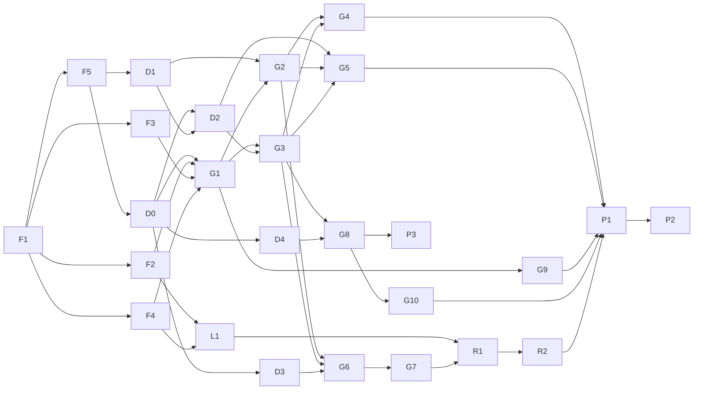

# Plan wdrożenia rozgrywki – pionowe kawałki (slices)

Ten dokument jest **głównym planem** wdrożenia. `implementation-plan.md` jest dokumentem historycznym (stan fundamentów); reguły gry opisuje `cluedo-rules.md` (sekcja „Implementation clarifications” jest wiążąca).

Cel: działająca dedukcyjna gra online dla 2–6 graczy według zasad z `cluedo-rules.md`, mobile first, desktop responsywnie, motyw jasny/ciemny, interfejs PL + EN, limit czasu tury ustawiany przez hosta, „Zagraj ponownie” w tym samym pokoju.

Jak zlecać pracę agentowi: *„Zaimplementuj slice `G3` z `docs/game-screens-plan.md`. Przeczytaj najpierw sekcje Architektura, Testowanie i Definition of Done.”* Agent pracuje w osobnym worktree/branchu `slice/<ID>-<krótka-nazwa>`, metodą TDD, a na końcu odhacza `[x]` w swoim slice.

---

## 1. Stan wyjściowy (audyt)

Działa: tworzenie/dołączanie do pokoju, wybór postaci, lista graczy, `room:start` (Playwright: 2 testy). `packages/game` ma planszę, karty i logikę tury z testami Vitest, ale nic nie jest podpięte do API ani UI.

Braki i problemy, które plan naprawia:

| Obszar | Problem | Slice |
|---|---|---|
| API | `room:start` tylko ustawia `phase = IN_PROGRESS`, nie wywołuje `startGame()` | G1 |
| Bezpieczeństwo | Tożsamość = `playerName`; kto zna kod i nazwę, gra za kogoś. Host rozpoznawany po nazwie w `LobbyScreen` | F2 |
| Reguły | Odpadli gracze są pomijani w obalaniu (powinni dalej obalać) | D3 |
| Reguły | Można spasować mając pasującą kartę (obalenie jest obowiązkowe) | D3 |
| Reguły | Oskarżenie tylko w fazie `ACTION` (powinno być w dowolnym momencie własnej tury, także po sugestii) | D4 |
| Reguły | Tajne przejście tylko po wejściu do pokoju (powinno być zamiast rzutu na początku tury) | D2 |
| Reguły | Na planszy są tylko pionki graczy (powinno być wszystkie 6, także nieużywane) | D0 |
| Reguły | Brak „wezwania do pokoju” – gracz przeniesiony cudzą sugestią może sugerować bez ruchu | D3 |
| Reguły | Tura może utknąć w `MOVE` (brak osiągalnych pól, a `endTurn` wymaga `DONE`/`ACTION`) | D2 |
| Reguły | Kolejność tur dowolna (powinna zaczynać czerwona postać, potem zgodnie z ruchem wskazówek zegara) | D0 |
| Plansza | Brak ścian i środka planszy, drzwi dostępne z każdej strony, pionek w pokoju zapisany jako pole drzwi | D1 |
| DRY | `characterIds` zduplikowane w `contracts`; `shuffle` i `Envelope` zduplikowane w `cards.ts`/`turn.ts`/`types.ts`; `reachableCells` skanuje planszę zamiast użyć `ROOM_DOORS`; te same walidacje tury powtarzane w każdej funkcji | F1, D0 |
| Błędy | Domena zwraca stringi, serwer wysyła angielskie komunikaty – nie da się ich przetłumaczyć | F1 |
| Testy | Brak testów API i web, brak konfiguracji lint (choć `turbo lint` istnieje), Playwright tylko mobile, brak deterministycznego RNG dla e2e | F1, G1 |
| Tożsamość | Logo „Cluedo”, postacie i grafiki z oryginalnej gry – `implementation-plan.md` wymaga oryginalnej oprawy | F5, D1 |

---

## 2. Architektura – wymagania obowiązujące każdy slice

### 2.1 Warstwy i kierunek zależności

```
packages/game  (czysta domena, zero zależności runtime)
      ▲
packages/contracts  (Zod + typy; identyfikatory importuje z game)
      ▲                 ▲
  apps/api          apps/web   (web może importować z game TYLKO dane statyczne: id, geometrię planszy)
```

- **Serwer jest autorytatywny.** Klient wysyła intencję, nigdy nie rozstrzyga o poprawności ruchu, sugestii, oskarżenia ani o tym, kto co widzi. Klient nie wywołuje funkcji reguł z `packages/game`.
- **Dozwolone akcje liczy domena**: `availableActions(game, playerId)` i `reachableFor(game, playerId)` w `packages/game`; serwer wysyła je w prywatnej projekcji. UI tylko pokazuje przyciski z tej listy (zero duplikacji reguł w UI).
- **Projekcje**: jedno miejsce (`GameProjector`) buduje stan publiczny i prywatny. Koperta, cudze ręce i pokazane karty nigdy nie trafiają do projekcji publicznej.
- **Losowość i czas wstrzykiwane** (`Rng`, `Clock`) – deterministyczne testy, brak `Math.random()`/`Date.now()` w logice.

### 2.2 Feature-based

Każda funkcjonalność ma własny folder we wszystkich warstwach; publiczne API folderu to jego `index.ts`. Importy do wnętrza innego feature'a są zabronione (wymusza lint).

```
packages/game/src/
  setup/  board/  movement/  suggestion/  accusation/  turn-flow/  shared/ (rng, result, errors)
packages/contracts/src/
  session/  rooms/  game/  errors.ts  events.ts (typy ClientToServer/ServerToClient)  index.ts
apps/api/src/
  modules/session/  modules/rooms/  modules/game/{commands/, projection/, notifier/, repository/}
  modules/testing/  (tylko gdy ENABLE_TEST_API=1)
  shared/ (walidacja Zod, filtr błędów WS, ack helper)
apps/web/src/
  app/ (routing ekranów, providery, AppHeader)
  features/join/  lobby/  game/  board/  turn/  suggestion/  disprove/  accusation/  notebook/  game-over/  theme/  i18n/
  shared/ui/  shared/lib/
apps/e2e/
  fixtures/ (wielu graczy, scenariusze)  pages/ (Page Objects)  tests/<feature>.spec.ts
```

### 2.3 Zasady

- **SOLID**
  - *SRP*: gateway = transport (parsowanie, ack), service = orkiestracja, domena = reguły, projector = widoczność, notifier = emisja.
  - *OCP*: nowe komendy i akcje dodaje się bez modyfikowania istniejących. API ma rejestr handlerów komend (`modules/game/commands/<akcja>.handler.ts`), a web rejestr akcji tury (`features/turn/actions.ts`: każda akcja to komponent z własnego feature'a).
  - *DIP*: `GameRepository`, `SessionRepository`, `Rng`, `Clock` jako interfejsy z implementacjami in-memory (DB w P3 bez zmian w serwisach).
  - *ISP*: małe interfejsy (`GameNotifier.toRoom`, `.toPlayer`), bez „god service”.
- **DRY**: jedno źródło identyfikatorów (game → contracts), nazwy zdarzeń socketów jako stałe w `contracts/events.ts`, wspólne komponenty kart (`CardTile`, `CardSelectGrid`) dla ręki, sugestii, oskarżenia i notatnika.
- **KISS/YAGNI**: bez Redux, bez CQRS-frameworków; stan gry w kontekście React + czyste selektory.
- **Niemutowalność i Result** w domenie: funkcje czyste, zwracają `{ ok: true, game } | { ok: false, code: GameErrorCode }`, bez wyjątków.
- **Kody błędów zamiast tekstów**: domena → `GameErrorCode` (union) → `errorCodeSchema` w contracts → web tłumaczy `t("errors.<code>")`. Serwer nie wysyła tekstów UI.
- **Komendy socketowe z potwierdzeniem (ack)**: `emit("turn:roll", payload, (res: CommandResult) => …)`; stan rozsyłany osobno zdarzeniami `game:state` / `game:private`.
- **Tożsamość z połączenia**: token sesji przekazywany w handshake (`auth.token`), serwer wiąże socket z graczem; komendy nie zawierają `playerName` ani tokenu.
- **i18n**: słowniki per feature (`features/x/i18n.ts` z `en` i `pl`), typ `pl` musi spełniać kształt `en` (TypeScript pilnuje kompletności).
- **Dostępność**: elementy interaktywne z rolą i nazwą (`role`, `aria-label`) – z tego korzystają selektory Playwright.
- **Style**: tylko tokeny CSS (F3), żadnych zakodowanych kolorów w komponentach.

### 2.4 Pliki „gorące” (konflikty przy pracy równoległej)

Do tych plików slice'y tylko **dopisują** wpisy (bez przebudowy): `contracts/src/index.ts`, `contracts/src/events.ts`, `api/.../commands/index.ts` (rejestr), `api/modules/testing/scenario.ts`, `web/features/turn/actions.ts`, `web/app/screens.tsx`, `web/i18n/index.ts` (rejestr słowników). Konflikty przy merge rozwiązuje się przez połączenie obu wpisów.

---

## 3. Testowanie

| Poziom | Narzędzie | Co testuje | Wymagane |
|---|---|---|---|
| Domena | Vitest (`packages/game`) | każda reguła, przypadki brzegowe, deterministyczny `Rng` | każdy slice D i każdy, który zmienia game; pokrycie ≥ 90% linii |
| API | Vitest + `@nestjs/testing` + `socket.io-client` | komendy, autoryzacja, **brak wycieku danych prywatnych** (rejestrujemy wszystkie zdarzenia odebrane przez gracza) | każdy slice z warstwą API |
| Web | Vitest + Testing Library (jsdom) | czyste selektory, złożone komponenty (notatnik, dialogi) | gdy jest logika w komponencie |
| E2E | Playwright, projekty `mobile-chromium` (iPhone 13) i `desktop-chromium` (1440×900) | scenariusz użytkownika z „Gotowe, gdy” | **każdy slice z UI** |

- **Scenariusze testowe**: `modules/testing` (włączany wyłącznie przez `ENABLE_TEST_API=1`, ustawiane w `playwright.config.ts`) udostępnia `POST /testing/rooms/:code/scenario`, którym test ustawia kopertę, ręce, pozycje pionków, fazę tury i kolejne rzuty kośćmi. Moduł powstaje w G1, a każdy kolejny slice dopisuje potrzebne pola.
- **Fixture'y Playwright**: `test.extend({ players })` tworzy N graczy (osobne konteksty przeglądarki) w jednym pokoju z wybranymi postaciami; Page Objects (`JoinPage`, `LobbyPage`, `GamePage`).
- **Selektory**: `getByRole`/`getByLabel` z nazwami EN (testy działają w locale `en-US`); `data-testid` tylko tam, gdzie nie ma sensownej roli.
- **Prywatność w e2e**: w testach widoczności sprawdzamy także, że tekst prywatny **nie występuje** w DOM innych graczy.

## 4. Definition of Done (każdy slice)

1. Wszystkie punkty slice'a odhaczone, „Gotowe, gdy” spełnione i pokryte testem Playwright (jeśli slice ma UI).
2. Zielone: `pnpm lint`, `pnpm typecheck`, `pnpm test`, `pnpm build`, `pnpm test:e2e`.
3. Nowe teksty w EN i PL; nowe kolory przez tokeny; działa w obu motywach i na obu viewportach.
4. Brak importów łamiących granice feature'ów; brak duplikacji reguł w UI.
5. Dokumentacja zaktualizowana, jeśli slice zmienia reguły lub kontrakty.

---

## 5. Zależności i równoległość



| Fala | Slice'y (równolegle) | Uwagi |
|---|---|---|
| 1 | F1 | fundament dla wszystkich |
| 2 | F2, F3, F4, F5 | F3 i F4 dodają przełączniki do `AppHeader` (slot z F1) |
| 3 | D0, D1, L1 | D0 i D1 to różne moduły game |
| 4 | D2, D3, D4, G1 | D2–D4 w osobnych modułach po refaktorze D0 |
| 5 | G2, G3, G9 | |
| 6 | G4, G5, G6, G8 | akcje tury jako osobne wpisy w rejestrze |
| 7 | G7, G10 | P3 (opcjonalny) może wystartować od tej fali |
| 8 | R1 | |
| 9 | R2 | |
| 10 | P1 | |
| 11 | P2 | |

Ścieżka krytyczna: F1 → F5 → D0 → G1 → G3 → G6 → G7 → R1 → R2 → P1 → P2.

---

## 6. Slice'y

Legenda warstw: **Game** `packages/game` · **Contracts** `packages/contracts` · **API** `apps/api` · **Web** `apps/web` · **E2E** `apps/e2e` · **Docs** `docs/`.

### Fundamenty

#### F1 – Narzędzia i ramy architektury
Zależy od: — · Cel: każdy kolejny slice ma gdzie i czym pisać kod i testy zgodnie z sekcją 2.

- [ ] **Repo:** ESLint (flat config, typescript-eslint) + `eslint-plugin-boundaries` z regułami z 2.1/2.2; Prettier; skrypt `lint` w każdym pakiecie
- [ ] **Contracts:** podział na `session/`, `rooms/`, `game/`, `errors.ts` (`errorCodeSchema`), `events.ts` (typowane `ClientToServerEvents`/`ServerToClientEvents`, `CommandResult`); `characterIds` (i inne id) importowane z `@mystery-game/game` zamiast duplikatu
- [ ] **API:** przeniesienie do `modules/rooms`; `shared/` z walidacją Zod dla WS, filtrem błędów mapującym na kody, helperem ack; istniejące komendy lobby odpowiadają przez ack z kodem błędu
- [ ] **API:** Vitest + `@nestjs/testing` + `socket.io-client`; testy istniejącego lobby (create, join, choose, start, błędy)
- [ ] **Web:** Vitest + Testing Library; `app/` z `AppHeader` (slot na przełączniki), `app/screens.tsx` (wybór ekranu wg stanu); `index.ts` jako publiczne API feature'ów; błędy z kodów (tymczasowo słownik EN)
- [ ] **E2E:** fixture `players(n)`, Page Objects `JoinPage`/`LobbyPage`; projekt `desktop-chromium`; istniejące testy przepisane na fixture'y
- [ ] **CI:** GitHub Actions: install → lint → typecheck → test → build → e2e (z `playwright install --with-deps`)
- [ ] **Docs:** krótki `docs/architecture.md` odsyłający do sekcji 2–4 tego planu

Gotowe, gdy: wszystkie komendy z DoD przechodzą lokalnie i w CI, a celowo błędny import między feature'ami powoduje błąd lint.

#### F2 – Sesje graczy (tokeny) i unikalne nazwy
Zależy od: F1 · Cel: nie da się grać za innego gracza; odświeżenie strony nie wyrzuca z pokoju.

- [ ] **Contracts:** odpowiedź `create`/`join` zawiera `{ room, session: { playerId, token } }`; `RoomSummary` zawiera `hostId`
- [ ] **API:** `modules/session`: `SessionRepository` (token UUID → `{ roomCode, playerId }`), middleware handshake (`socket.data.playerId`); usunięcie `playerIdByName` jako źródła tożsamości; komendy lobby bez `playerName`
- [ ] **API:** `join` z zajętą nazwą w pokoju → kod `NAME_TAKEN`; ta sama nazwa w innym pokoju jest poprawna
- [ ] **API:** `GET /rooms/:code/session` (z tokenem) – przywrócenie sesji po odświeżeniu
- [ ] **Web:** token w `localStorage` per kod pokoju; połączenie socketu z `auth.token`; automatyczny powrót do pokoju po odświeżeniu; host rozpoznawany po `hostId`; komunikat o zajętej nazwie
- [ ] **Testy:** API – duplikat nazwy, ta sama nazwa w 2 pokojach, komenda bez/z nieprawidłowym tokenem odrzucona, gracz nie może wykonać akcji hosta; E2E – odświeżenie strony zachowuje gracza i jego postać

Gotowe, gdy: odświeżenie strony przywraca gracza, a komenda wysłana z cudzą nazwą bez tokenu jest odrzucana.
Poza zakresem: JWT, wygasanie sesji (P3).

#### F3 – Motyw jasny/ciemny
Zależy od: F1

- [ ] **Web:** tokeny CSS (tło, tekst, akcent zielony, hover, disabled, ramki, powierzchnie kart, kolory pól planszy); paleta ciemna z zachowaniem zielonego akcentu i kontrastu AA
- [ ] **Web:** przełącznik „Jasny / Ciemny / Systemowy” w `AppHeader` (domyślnie systemowy); zapis w `localStorage`; `data-theme` na `<html>` ustawiane skryptem w `index.html` (bez migania)
- [ ] **Web:** zastosowanie na wszystkich istniejących ekranach
- [ ] **Testy:** E2E – wybór motywu zmienia `data-theme` i przetrwa odświeżenie; emulacja `prefers-color-scheme: dark`

Gotowe, gdy: oba motywy działają na wszystkich ekranach, a wybór użytkownika ma pierwszeństwo przed systemowym.

#### F4 – Język PL/EN
Zależy od: F1

- [ ] **Web:** słowniki per feature (`en` + `pl`, `pl` typowany kształtem `en`); hook `useT()` z re-renderem po zmianie języka; przełącznik EN/PL w `AppHeader`; zapis w `localStorage`; domyślnie wg `navigator.language`; `<html lang>`
- [ ] **Web:** tłumaczenia istniejących ekranów i kodów błędów
- [ ] **Testy:** Vitest – kompletność kluczy (dodatkowo do TS); E2E – przełączenie na PL zmienia etykiety i przetrwa odświeżenie

Gotowe, gdy: cały istniejący interfejs działa po polsku i angielsku.

#### F5 – Oryginalna tożsamość gry
Zależy od: F1 · Cel: mechanika według zasad dedukcji, ale własna oprawa (wymóg z `implementation-plan.md`). Na tym etapie wystarczą **neutralne placeholdery**; docelowe nazwy i grafiki podmienia się później w jednym miejscu (i18n + mapa obrazków), bez zmian w kodzie gry.

- [ ] **Game/Contracts:** neutralne id postaci według koloru (`red`, `yellow`, `white`, `green`, `blue`, `purple`); `knife` → `dagger`; nazwy wyświetlane wyłącznie z i18n
- [ ] **Web (placeholdery):** postacie nazwane kolorem (np. „Pani Czerwona” / „Ms. Red”) z awatarem w kolorze postaci; bronie z ikonami (`lucide-react`); pokoje z nazwą i prostą ikoną; roboczy tytuł gry zamiast logo „Cluedo”; pliki z `images/` usunięte z aplikacji
- [ ] **Web:** jedno miejsce mapowania wyglądu kart (`features/cards/cardArt.ts`), żeby podmiana na docelowe grafiki była jedną zmianą
- [ ] **Testy/E2E:** aktualizacja id i selektorów
- [ ] **Docs:** `cluedo-rules.md` – tabela mapowania postaci (kolor → nazwa w grze)

Gotowe, gdy: w UI i kodzie nie ma nazw ani grafik z oryginalnej gry, a wszystkie testy przechodzą.

### Domena (packages/game)

#### D0 – Refaktor modułów domeny i przygotowanie gry
Zależy od: F5 · Cel: podział na moduły umożliwiający równoległą pracę D2–D4.

- [ ] **Game:** podział `turn.ts` na `setup/`, `movement/`, `suggestion/`, `accusation/`, `turn-flow/`; wspólne `shared/` (`shuffle`, `Result`, `GameErrorCode`, `requireActivePlayer`, `findPlayerToken`) – usunięcie duplikatów `shuffle`/`Envelope`
- [ ] **Game:** `GameErrorCode` jako union zamiast `string`
- [ ] **Game:** `availableActions(game, playerId)` (na razie dla obecnych reguł) – jedyne źródło dozwolonych akcji dla UI
- [ ] **Game:** `startGame`: wszystkie 6 pionków na polach startowych; bronie po jednej w 6 losowych pokojach; kolejność tur wg stałej `SEAT_ORDER` (czerwona pierwsza, potem zgodnie z ruchem wskazówek zegara), tylko gracze uczestniczący; min. 2 graczy
- [ ] **Testy:** Vitest – dotychczasowe testy przechodzą po refaktorze; nowe dla setupu (6 pionków, kolejność, rozdanie 2–6 graczy, w tym 9/9)

Gotowe, gdy: testy domeny przechodzą, publiczne API pakietu jest zachowane lub zaktualizowane u wywołujących.

#### D1 – Plansza: oryginalny układ i model położenia
Zależy od: F5 (równolegle z D0)

- [ ] **Game:** własny układ 24×25 (9 pokoi, korytarze, ściany, środek planszy niedostępny); referencja z Figmy służy tylko jako styl wizualny, nie jako układ do skopiowania
- [ ] **Game:** drzwi z kierunkiem (wejście tylko z pola korytarza przed drzwiami); 2 pary tajnych przejść między narożnymi pokojami; 6 pól startowych na krawędzi
- [ ] **Game:** model położenia `{ kind: "cell", position } | { kind: "room", roomId }` zamiast pola drzwi
- [ ] **Game:** `BOARD_LAYOUT` dla renderu: prostokąty/wielokąty pokoi, punkty etykiet, segmenty drzwi, znaczniki przejść, sloty na pionki i bronie w każdym pokoju
- [ ] **Testy:** Vitest – każdy pokój osiągalny z każdego pola startowego, wszystkie pokoje mają drzwi, przejścia są parami, środek niedostępny, snapshot ASCII planszy

Gotowe, gdy: plansza jest spójna (testy grafu), a `reachableCells` działa na nowym modelu.

#### D2 – Reguły ruchu i przebiegu tury
Zależy od: D0, D1

- [ ] **Game:** na początku tury w pokoju z przejściem: tajne przejście **zamiast** rzutu
- [ ] **Game:** wyjście z pokoju tylko przez drzwi; zakaz ponownego wejścia do pokoju opuszczonego w tej turze; ruch „do” wyrzuconej liczby, bez przechodzenia przez zajęte pola korytarza
- [ ] **Game:** wejście do pokoju kończy ruch i pozwala na sugestię; pozostanie w pokoju bez ruchu nie pozwala na sugestię (wyjątek: D3)
- [ ] **Game:** zakończenie tury możliwe w każdej fazie własnej tury poza oczekiwaniem na obalenie (brak blokady w `MOVE`)
- [ ] **Game:** `reachableFor(game, playerId)`; `availableActions` uwzględnia powyższe
- [ ] **Testy:** Vitest dla każdej reguły (w tym zablokowany pokój i zablokowane drzwi)

#### D3 – Reguły sugestii i obalania
Zależy od: D0

- [ ] **Game:** sugestia tylko w pokoju, do którego gracz wszedł w tej turze, albo w pokoju, do którego został wezwany (`summonedTo`); jedna sugestia na turę
- [ ] **Game:** sugestia przenosi wskazany pionek (dowolny z 6) i broń do pokoju; przeniesionemu graczowi ustawia `summonedTo`
- [ ] **Game:** kolejka obalających zgodnie z ruchem wskazówek zegara, **łącznie z odpadłymi**
- [ ] **Game:** obalenie obowiązkowe: `pass` z pasującą kartą → `CARD_REQUIRED`; `matchingCards(hand, suggestion)`; automatyczny pas gracza bez pasujących kart (funkcja `autoResolveDisprove`)
- [ ] **Testy:** Vitest dla każdej reguły, w tym „nikt nie obalił” i obalenie przez odpadłego gracza

#### D4 – Reguły oskarżenia i końca gry
Zależy od: D0

- [ ] **Game:** oskarżenie w dowolnym momencie własnej tury (przed rzutem, po ruchu, po sugestii), poza oczekiwaniem na obalenie; dowolny pokój
- [ ] **Game:** błędne oskarżenie: gracz odpada, jego tura kończy się automatycznie, pionek zostaje na planszy, nadal obala; wynik prywatny zawiera kopertę (oskarżający ją widzi)
- [ ] **Game:** ostatni nieodpadły gracz wygrywa automatycznie (`winReason: "LAST_STANDING"`); poprawne oskarżenie → `winReason: "ACCUSATION"`; po `FINISHED` wszystkie komendy odrzucane
- [ ] **Testy:** Vitest – poprawne/błędne oskarżenie, 2 graczy (błąd jednego = wygrana drugiego), łańcuch eliminacji

### Lobby

#### L1 – Ustawienia pokoju: limit czasu tury
Zależy od: F2, F4

- [ ] **Game/Contracts:** `RoomSettings { turnTimeLimitSec: null | 60 | 90 | 120 | 180 }` (domyślnie 120); zmiana tylko w `LOBBY` i tylko przez hosta
- [ ] **API:** komenda `room:settings`, walidacja hosta
- [ ] **Web:** wybór limitu w lobby (host: kontrolka, pozostali: tylko odczyt)
- [ ] **Testy:** API – nie-host odrzucony, zmiana po starcie odrzucona; E2E – host zmienia limit, drugi gracz widzi nową wartość

### Rozgrywka (pionowe slice'y)

#### G1 – Start gry, prywatna ręka i szkielet ekranu gry
Zależy od: F2, F3, F4, D0

- [ ] **Contracts:** `publicGameStateSchema` (gracze z postaciami, kolejność, aktywny gracz, faza tury, odpadli, liczba kart, położenia pionków i broni, ostatnie zdarzenia, zwycięzca) i `privateGameStateSchema` (ręka, `availableActions`); zdarzenia `game:state`, `game:private`
- [ ] **API:** `modules/game`: `GameService`, `GameRepository` (in-memory), `GameProjector`, `GameNotifier` (pokój + kanał `player:<id>`), dostawca `Rng`; `RoomsService.start()` wywołuje `startGame()`; po ponownym połączeniu wysyła oba stany
- [ ] **API:** `modules/testing` + `POST /testing/rooms/:code/scenario` (koperta, ręce)
- [ ] **Web:** `features/game`: `GameScreen` po `phase === "IN_PROGRESS"`, `GameProvider` + `useGame()`, `PlayersBar` (awatary, aktywny wyróżniony), `CardHand`, wskaźnik tury; wspólne `CardTile` i `CardSelectGrid`; miejsce na planszę; układ mobilny (plansza u góry, pod nią gracze i karty) i desktopowy (plansza po lewej, panel po prawej)
- [ ] **Testy:** API – projekcja publiczna i zdarzenia odebrane przez gracza nie zawierają koperty ani cudzych kart; rozmiary rąk dla 2–6 graczy; E2E – 3 graczy startuje, każdy widzi tylko swoje (ustawione scenariuszem) karty; odświeżenie przywraca rękę

Gotowe, gdy: host startuje grę, każdy widzi graczy i tylko swoje karty, odświeżenie przywraca widok.

#### G2 – Plansza (SVG, tylko podgląd)
Zależy od: G1, D1

- [ ] **Web:** `features/board`: inline SVG z `BOARD_LAYOUT` (pola, ściany, drzwi, pokoje z etykietami i18n, znaczniki przejść), pionki i bronie ze stanu publicznego w slotach pokoi; kolory z tokenów; `role`/`aria-label` (np. „Red – Kitchen”)
- [ ] **Web:** mobile: przybliżanie i przesuwanie (pointer events na `viewBox`; jeśli nie wystarczy – `react-zoom-pan-pinch`)
- [ ] **Testy:** Vitest – render 6 pionków i 6 broni; E2E – wszyscy widzą pionki na polach startowych i bronie w pokojach; zrzut ekranu planszy w obu motywach (`toHaveScreenshot`)

#### G3 – Rzut kośćmi, koniec tury, dziennik zdarzeń
Zależy od: G1, D2

- [ ] **Contracts:** komendy `turn:roll`, `turn:end`; `GameEvent` (union zdarzeń publicznych) w stanie
- [ ] **API:** handlery w rejestrze komend; rzut po stronie serwera (`Rng`); scenariusz: kolejne rzuty kośćmi
- [ ] **Web:** `features/turn`: `TurnPanel` z rejestrem akcji (`actions.ts`), `RollAction` (wynik dwóch kości), `EndTurnAction`; pozostali widzą „Ruch gracza X”; `EventLog` renderujący `GameEvent` przez i18n
- [ ] **Testy:** API – rzut poza turą → `NOT_YOUR_TURN`; E2E – A rzuca (3+4), oba ekrany pokazują 7 w dzienniku, A kończy turę, aktywny jest B, A nie ma przycisku rzutu

#### G4 – Ruch po planszy
Zależy od: G2, G3

- [ ] **Contracts/API:** komenda `turn:move`; `reachable` w stanie prywatnym; scenariusz: pozycje pionków
- [ ] **Web:** podświetlenie osiągalnych pól jako klikalne elementy z `aria-label`; animacja ruchu (`transform`, z `prefers-reduced-motion`); wpis w dzienniku („X wchodzi do Kuchni”)
- [ ] **Testy:** E2E – ruch na korytarz, wejście do pokoju przez drzwi, pole zajęte nie jest podświetlone, drugi gracz widzi nową pozycję

#### G5 – Tajne przejście
Zależy od: G2, G3, D2

- [ ] **Contracts/API:** komenda `turn:passage`
- [ ] **Web:** `PassageAction` (tylko gdy w `availableActions`); wpis w dzienniku
- [ ] **Testy:** E2E – gracz zaczyna turę w narożnym pokoju (scenariusz), używa przejścia zamiast rzutu, pionek ląduje w pokoju naprzeciw, przycisk rzutu znika

#### G6 – Sugestia (z automatycznym pasowaniem)
Zależy od: G2, G3, D3

- [ ] **Contracts/API:** komenda `turn:suggest`; po sugestii serwer automatycznie pasuje za graczy bez pasujących kart (zdarzenie „X nie może obalić”); stan publiczny pokazuje, na kogo czekamy
- [ ] **Web:** `SuggestAction` + `SuggestionDialog` (podejrzany + broń na `CardSelectGrid`, pokój narzucony); dziennik: „A sugeruje: Red, Rope, Kitchen”, „Nikt nie obalił”
- [ ] **Testy:** E2E – ręce bez dopasowań → wszyscy widzą „Nikt nie obalił”, pionek podejrzanego i broń w pokoju; wezwany gracz w swojej turze może sugerować bez ruchu

#### G7 – Obalanie i prywatne ujawnienie karty
Zależy od: G6

- [ ] **Contracts/API:** `game:private` dla obalającego zawiera `disproveRequest` (pasujące karty); komenda `turn:disprove { cardId }`; pokazana karta tylko w stanie prywatnym sugerującego (`seenCards`), pozostali dostają „B pokazał kartę A”
- [ ] **Web:** `features/disprove`: panel obalającego (wybór jednej z pasujących kart, bez przycisku „Pas”), widok sugerującego (karta i od kogo), pozostali (informacja bez karty); stany oczekiwania
- [ ] **Testy:** API – socket trzeciego gracza nie otrzymuje id pokazanej karty w żadnym zdarzeniu; E2E – 3 graczy: B wybiera kartę, A ją widzi, w DOM C nie ma nazwy karty

#### G8 – Oskarżenie, odpadnięcie i koniec gry
Zależy od: G3, D4

- [ ] **Contracts/API:** komenda `turn:accuse`; wynik prywatny (koperta dla błędnie oskarżającego); stan publiczny: odpadli, zwycięzca, `winReason`, koperta po zakończeniu
- [ ] **Web:** `AccuseAction` + `AccusationDialog` (3 × `CardSelectGrid`, ostrzeżenie o odpadnięciu); baner „Odpadłeś – nadal obalasz”; `features/game-over`: `GameOverScreen` (zwycięzca, koperta, wariant: wygrana / przegrana / ostatni gracz), „Wróć do menu”
- [ ] **Testy:** E2E – poprawne oskarżenie kończy grę u wszystkich; błędne eliminuje gracza (widzi kopertę, inni nie), gra trwa dalej; w grze 2-osobowej błąd jednego = wygrana drugiego

#### G9 – Notatnik detektywa
Zależy od: G1

- [ ] **Web:** `features/notebook`: siatka podejrzani/bronie/pokoje; komórka cyklicznie puste → ✓ → ✗ → ?; własne karty zaznaczone; zapis w `localStorage` per `gameId` + `playerId`; zakładka (mobile) / panel (desktop)
- [ ] **Web:** jeśli G7 jest gotowy – karty pokazane graczowi (`seenCards`) zaznaczane automatycznie
- [ ] **Testy:** Vitest – cykl stanów i pre-zaznaczenie; E2E – zaznaczenia przetrwają odświeżenie

#### G10 – Zagraj ponownie w tym samym pokoju
Zależy od: G8

- [ ] **Game/API:** `room:restart` (tylko host, tylko `FINISHED`) → pokój wraca do `LOBBY` z tymi samymi graczami, postaciami i ustawieniami, nowym `gameId`
- [ ] **Web:** przycisk „Zagraj ponownie” dla hosta na `GameOverScreen`; pozostali automatycznie przechodzą do lobby; nowy notatnik (nowy `gameId`)
- [ ] **Testy:** E2E – po zakończeniu host restartuje, wszyscy są w lobby, można rozpocząć nową grę z nową kopertą

### Odporność

#### R1 – Limit czasu tury
Zależy od: L1, G7

- [ ] **API:** `TurnClock` z wstrzykiwanym `Clock`; termin (`deadline`) w stanie publicznym; po upływie limitu tura kończy się automatycznie (zdarzenie „Czas minął”); obalający ma osobny limit 30 s, po którym serwer pokazuje losową pasującą kartę; bez limitu (`null`) brak timera tury
- [ ] **API:** scenariusz: skrócenie limitów w testach
- [ ] **Web:** licznik czasu przy aktywnym graczu i u obalającego
- [ ] **Testy:** API (fałszywy zegar) – timeout tury i obalania; E2E – przy limicie skróconym scenariuszem tura przechodzi na następnego gracza

#### R2 – Rozłączenia i powrót do gry
Zależy od: R1

- [ ] **API:** obecność graczy (connect/disconnect per gracz, wiele kart przeglądarki); rozłączony gracz zachowuje miejsce; jeśli ma turę lub obala – karencja 60 s (konfigurowalna), potem pominięcie tury / automatyczne pokazanie karty (wspólny mechanizm z R1)
- [ ] **API:** po ponownym połączeniu: stan publiczny, ręka, oczekujące `disproveRequest`, `seenCards`
- [ ] **Web:** wskaźnik rozłączonego gracza w `PlayersBar`; komunikat o ponownym łączeniu
- [ ] **Testy:** API – karencja i pominięcie; E2E – gracz zamyka kontekst w trakcie swojej tury, inni widzą wskaźnik, po karencji tura przechodzi dalej; powrót przywraca rękę

### Dopracowanie

#### P1 – Responsywność, dostępność, pełne gry
Zależy od: G4, G5, G9, G10, R2

- [ ] **Web:** dopracowanie 375×812 i 1440×900; pola dotykowe ≥ 44 px; fokus i pułapka fokusu w dialogach; obsługa klawiatury na planszy; `prefers-reduced-motion`
- [ ] **Testy:** `@axe-core/playwright` na każdym ekranie w obu motywach; pełna gra 2 i 6 graczy (scenariusz) od lobby do zwycięzcy; zrzuty ekranów głównych widoków

#### P2 – Design w Figmie
Zależy od: P1

- [ ] **Docs/Design:** eksport ekranów (mobile/desktop, oba motywy) do `docs/design/` i planszy jako SVG
- [ ] **Figma:** wgranie ekranów jednym wywołaniem `html_to_figma` (limit MCP)

#### P3 (opcjonalny) – Persystencja w bazie danych
Zależy od: G8 (stabilne `GameRepository`/`SessionRepository`)

- [ ] **API/DB:** PostgreSQL + Prisma jako implementacje repozytoriów; migawki gry i log zdarzeń; wygasanie sesji
- [ ] **Testy:** integracyjne na prawdziwej bazie (Docker Compose), odtworzenie pokoju po restarcie API

---

## 7. Poza zakresem (do decyzji później)

Opuszczanie pokoju i przekazanie roli hosta, wyrzucanie graczy, obserwatorzy, czat, boty, konta, ranking, publiczne wyszukiwanie pokoi, gra offline.
