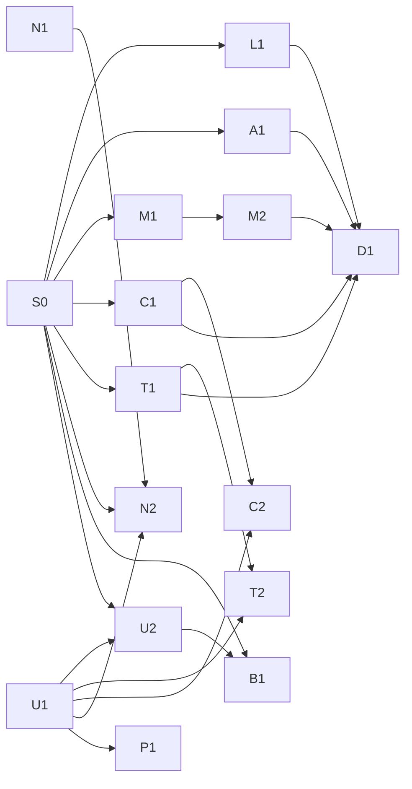

> **Archived – not current.** Kept for history only. Current state: [`docs/README.md`](../../README.md). Do not use this file as a source of requirements or tasks.

# TODO Implementation Plan (house-rule options, timers, room cards, game-screen UX, version)

> **For agentic workers:** REQUIRED SUB-SKILL: Use superpowers:subagent-driven-development (recommended) or superpowers:executing-plans to implement this plan task-by-task. Steps use checkbox (`- [ ]`) syntax for tracking.
>
> **How to assign a task to an agent:** *"Implement task `A1` from `docs/todo-implementation-plan.md`. First read: Global Constraints, Review Focus, §Parallelism and your task. Spec: `docs/todo.md` (item named in the task). Architecture: `docs/game-screens-plan.md` §2–§4."* One task = one worktree/branch `todo/<ID>-<short-name>` off `main`, TDD, tick `[x]` in this file and in `docs/todo.md` when done.

**Goal:** Implement every open item of `docs/todo.md` (items 1–9 + "Shared" + "To verify") without breaking the existing architecture.

**Architecture:** *Contract-first.* Task `S0` adds **all** new types, settings, error codes, events and projection fields up front (with neutral placeholder values), so every later task only fills in behaviour inside its own feature folder and the "hot" files are touched by `S0` alone (or append-only). Rules stay in `packages/game` (pure, `Result`, injected `Rng`); the API only orchestrates/projects/schedules; the web only renders what the server allows.

**Tech Stack:** pnpm + Turborepo, TypeScript strict, Zod 4, NestJS 11 + Socket.IO 4, React 19 + Vite 7 + Tailwind 4 (CSS tokens), Vitest, Testing Library, Playwright (`mobile-chromium`, `desktop-chromium`).

**Spec:** `docs/todo.md` (requirements, in Polish). Binding background: `docs/game-screens-plan.md` §2 Architecture, §3 Testing, §4 Definition of Done; `docs/cluedo-rules.md` "Implementation clarifications".

## Global Constraints

- Layers: `game` ← `contracts` ← `api`/`web`. Web may import from `@mystery-game/game` **only static data** (ids, board layout). No rule duplication in the UI: buttons come from `me.availableActions`.
- Domain functions are pure and immutable, return `GameResult` (`ok(game)` / `fail(code)`), never throw; randomness via `Rng`, time via injected `Clock`/`Timer` (no `Math.random()`/`Date.now()`/`setTimeout` in logic).
- Error codes, not texts: a new `GameErrorCode` must also be in `packages/contracts/src/errors.ts` `errorCodes` and translated (EN + PL) in `apps/web/src/shared/errors/i18n.ts`.
- Feature folders; a folder's public API is its `index.ts`; no imports into another feature's internals.
- i18n: every new UI string in `features/<x>/i18n.ts` with `en` and `pl` (`pl` typed by `en`).
- Styles: Tailwind with CSS tokens from `apps/web/src/styles.css` only; new colours = new tokens in **both** themes. Animations disabled under `prefers-reduced-motion: reduce`.
- `localStorage` access always in `try/catch`; app works when storage throws.
- Accessibility: interactive elements have role + accessible name; Playwright selects by role/label with **EN** names.
- Privacy: shown cards, room-card ids, hands and the envelope never enter the public projection or public events. Every task that adds private data adds an API test asserting a third player's socket never receives it.
- Defaults (verbatim from spec): accusation place `any_room`; accuse after suggestion **on**; suggest after staying **off**; turn limit **90 s** (options none/30/60/90/120/180); disprove limit **30 s** (options none/15/30/45/60); room cards **0** (0–8); automatic notes **on**.
- Settings: changed by the host only, only in `LOBBY`; visible to all players; preserved on room restart (return to lobby).
- No migration of old notebook storage: new key prefix, old entries are ignored.
- Definition of Done per task: `pnpm lint && pnpm typecheck && pnpm test && pnpm build && pnpm test:e2e` green (lint = layer/feature boundaries, `eslint.config.mjs`); EN+PL texts; both themes; both viewports; docs updated only where the task says so (rules doc is updated centrally in `D1`).

## Review Focus

1. **Summoned player rolls after suggesting / suggests after rolling.** A player summoned to a room who has *already rolled* must not be able to suggest and then still move; and after suggesting must not roll, move or use a passage. → tests in `M1` (`movePawn`/`reachableFor` blocked when `hasSuggested`).
2. **Timer races.** A turn/disprove timeout firing after the turn already changed (or after the game ended / returned to lobby / room deleted) must be a no-op; turn timer must be paused (not reset) while someone disproves and resumed with the remaining time. → tests in `T1` (`stale timeout is ignored`, `turn timer pauses during disprove`).
3. **Room cards leaking.** A room card id must not reach players who never stood in that room, nor any public event/state. → API privacy test in `C1`.
4. **Deduction on contradictory/manual data.** Deduction must use facts only (never manual marks), terminate (fixed point with an iteration bound), and a manual mark must always win in display. → tests in `N1`/`N2`.
5. **Mobile notebook width.** With 5 other players (6-player game) the table must fit 360 px without horizontal page scroll. → Playwright test in `N2` at viewport 360×780.

---

## Parallelism



| Wave | Tasks (run in parallel) | Notes |
|---|---|---|
| 0 | **S0**, **U1**, **N1**, **V1** | S0 = contracts/domain/API foundation; U1 web layout only; N1 pure function; V1 independent |
| 1 | L1, A1, M1, C1, T1, U2, P1 | need S0 and/or U1 |
| 2 | M2, T2, C2, N2, B1 | |
| 3 | D1 | docs sync after all rule tasks |

Critical path: S0 → T1 → T2 (and U1 → N2).

**Hot files** (conflict-prone; only append, resolve merges by keeping both entries):
`apps/api/src/modules/game/commands/index.ts`, `apps/api/src/modules/testing/scenario.ts`, `packages/contracts/src/testing/index.ts`, `packages/game/src/index.ts` (exports), `apps/web/src/features/game/ActionSection.tsx` (slot list, created by U1), `apps/e2e/pages/GamePage.ts`, `apps/web/src/features/board/Board.tsx` (P1 edits only the toolbar block, B1 only SVG layers).
`errors.ts`, error i18n, contract schemas and `GameEvent` are **owned by S0** – later tasks must not need to change them; if they do, stop and report.

---

## Task S0: Settings, codes, events and projection fields (foundation)

Spec: todo "Shared for 1, 2, 4, 5, 6, 7, 8f", 8f "server: full event history". No behaviour of items 1–7 yet.

**Files:**
- Modify: `packages/game/src/shared/types.ts`, `packages/game/src/shared/result.ts`, `packages/game/src/lobby/index.ts`, `packages/game/src/setup/index.ts`, `packages/game/src/index.ts`
- Create: `packages/game/test/settings.test.ts`
- Create: `packages/contracts/src/settings/index.ts`; Modify: `packages/contracts/src/{index.ts,errors.ts,events.ts,game/index.ts,rooms/index.ts}`
- Create: `apps/api/src/modules/game/commands/settings.handler.ts`; Modify: `commands/index.ts`, `projection/game.projector.ts`, `apps/api/test/game.test.ts`, `apps/api/test/rooms.test.ts`
- Modify (web, compile + texts only): `apps/web/src/shared/errors/i18n.ts`, `apps/web/src/features/event-log/{describe.ts,i18n.ts}`, `apps/web/src/features/game/testFixtures.ts`

**Interfaces – Produces:**
```ts
// packages/game/src/shared/types.ts
export const turnTimeLimits = [null, 30, 60, 90, 120, 180] as const;
export const disproveTimeLimits = [null, 15, 30, 45, 60] as const;
export const MAX_ROOM_CARDS = 8;
export type AccusationPlace = "any_room" | "named_room";
export interface RoomSettings {
  readonly accusationPlace: AccusationPlace;
  readonly accuseAfterSuggestion: boolean;
  readonly suggestAfterStaying: boolean;
  readonly turnTimeLimitSec: (typeof turnTimeLimits)[number];
  readonly disproveTimeLimitSec: (typeof disproveTimeLimits)[number];
  readonly roomCards: number;            // integer 0..MAX_ROOM_CARDS
  readonly autoNotes: boolean;
}
export const DEFAULT_ROOM_SETTINGS: RoomSettings; // any_room, true, false, 90, 30, 0, true
// Game gets: readonly settings: RoomSettings
// PlayState gets: readonly roomCards: Readonly<Partial<Record<RoomId, CardId>>>  (setup: {})
// GameEvent gets:
//   | { type: "turn_timed_out"; playerId }
//   | { type: "disprove_timed_out"; playerId }   // emitted right before the auto card_shown
// GameErrorCode gets: "NOT_IN_ROOM" | "WRONG_ROOM" | "ACCUSE_AFTER_SUGGESTION_DISABLED"
//                   | "ALREADY_SUGGESTED" | "INVALID_SETTINGS"
// packages/game/src/lobby/index.ts
export function updateSettings(game: Game, byPlayerId: PlayerId, patch: Partial<RoomSettings>): GameResult;
// NOT_HOST → GAME_NOT_IN_LOBBY → INVALID_SETTINGS (value not in the option lists / roomCards not int 0..8)
```
```ts
// packages/contracts/src/settings/index.ts
export const roomSettingsSchema;               // mirrors RoomSettings (z.union of z.literal for limits)
export const updateSettingsSchema = roomSettingsSchema.partial();
export type RoomSettings; export type UpdateSettingsRequest;
// rooms: roomSummarySchema.settings: roomSettingsSchema
// game:  publicGameStateSchema += {
//          settings: roomSettingsSchema,
//          timer: { kind: "turn" | "disprove", playerId, remainingMs: int≥0, durationMs: int>0 } | null,
//          roomsWithCards: RoomId[] }
//        privateGameStateSchema += { roomCards: { roomId, cardId }[] }  // rooms this player has stood in
//        gameEventSchema += turn_timed_out, disprove_timed_out
// events.ts: ClientEvents.updateSettings = "room:settings"; ClientToServerEvents["room:settings"]
// errors.ts: the 5 new codes
```
- Projector placeholders (filled later): `timer: null` (T1), `roomsWithCards: []` and `roomCards: []` (C1). Projector sends **all** events (delete `EVENT_WINDOW`; `seq` = index).

- [x] **Step 1: Write failing domain tests** in `packages/game/test/settings.test.ts`:
  - `createGame uses DEFAULT_ROOM_SETTINGS` → `expect(game.settings).toEqual({ accusationPlace: "any_room", accuseAfterSuggestion: true, suggestAfterStaying: false, turnTimeLimitSec: 90, disproveTimeLimitSec: 30, roomCards: 0, autoNotes: true })`
  - `host updates settings in lobby` → `updateSettings(g, host, { turnTimeLimitSec: 30 })` ok, other fields unchanged
  - `non-host is rejected` → `NOT_HOST`; `after start is rejected` → `GAME_NOT_IN_LOBBY`
  - `invalid values are rejected` → `{ turnTimeLimitSec: 45 }`, `{ disproveTimeLimitSec: 90 }`, `{ roomCards: 9 }`, `{ roomCards: 1.5 }` → `INVALID_SETTINGS`
  - `settings survive returnToLobby` → finish a game, `returnToLobby` keeps `settings`
  - `startGame initialises roomCards to {}`
- [x] **Step 2:** Run `pnpm --filter @mystery-game/game test` → FAIL (`updateSettings` not exported).
- [x] **Step 3:** Implement the types and `updateSettings` above; export `updateSettings`, `DEFAULT_ROOM_SETTINGS`, `turnTimeLimits`, `disproveTimeLimits`, `MAX_ROOM_CARDS` from `src/index.ts`.
- [x] **Step 4:** Run game tests → PASS.
- [x] **Step 5: Failing API tests** (`apps/api/test/rooms.test.ts`, `game.test.ts`):
  - `room:settings by host broadcasts room:state with new settings to all players`
  - `room:settings by non-host acks NOT_HOST`; `room:settings with { roomCards: 99 } acks INVALID_PAYLOAD` (Zod) 
  - `game:state contains settings, timer null, roomsWithCards []`; `game:private contains roomCards []`
  - `game:state contains the full event history` – produce > 50 events (e.g. 30 × roll+end_turn via scenario dice) and assert `events.length === play.events.length` and `events[0].seq === 0`
- [x] **Step 6:** Implement contracts, `settings.handler.ts` (`event: "room:settings"`, `schema: updateSettingsSchema`, `execute: (g, p, payload) => updateSettings(g, p, payload)`), register it, projector fields. Web: add EN/PL error texts for the 5 codes, `describe.ts` cases (`turn_timed_out`: "{name}'s time ran out" / "Czas gracza {name} minął"; `disprove_timed_out`: "{name} did not choose in time – a random card was shown" / "{name} nie wybrał na czas – pokazano losową kartę"), fixtures get the new fields.
- [x] **Step 7:** `pnpm lint && pnpm typecheck && pnpm test && pnpm build && pnpm test:e2e` → all green.
- [x] **Step 8:** Commit `feat(settings): room settings, new error codes/events and projection fields`.

## Task V1: App version on the home screen

Spec: todo item 9. Depends on: —.

**Files:** Create `apps/web/src/app/version.ts`, `apps/web/src/app/version.test.ts`; Modify `apps/web/vite.config.ts`, `apps/web/src/vite-env.d.ts`, `apps/web/src/shared/ui/ScreenLayout.tsx` (optional `footer` prop), `apps/web/src/features/join/{JoinScreen.tsx,i18n.ts}`, `Dockerfile`, `docker-compose.yml`, `README.md` (one line on `GIT_SHA`), `apps/e2e/tests/lobby.spec.ts`.

**Interfaces – Produces:** `formatBuildVersion(isoUtc: Date, sha?: string): string` → `"2026-11-16T14:32Z"` or `"2026-11-16T14:32Z (13c8392)"`; global `declare const __APP_VERSION__: string`.

- [x] **Step 1: Failing tests** `version.test.ts`: `formats to minutes in UTC` (`new Date("2026-11-16T14:32:59.999Z")` → `"2026-11-16T14:32Z"`); `appends short sha` (`"abc1234"` → `"… (abc1234)"`); `empty sha is ignored`.
- [x] **Step 2:** Run `pnpm --filter @mystery-game/web test version` → FAIL.
- [x] **Step 3:** Implement `formatBuildVersion`. In `vite.config.ts` use the function form `defineConfig(({ command }) => …)` and `define: { __APP_VERSION__: JSON.stringify(command === "serve" ? "dev" : formatBuildVersion(new Date(), process.env.GIT_SHA)) }` (no git calls – `.git` is dockerignored). `Dockerfile` build stage: `ARG GIT_SHA=` + `ENV GIT_SHA=$GIT_SHA`; compose `web.build.args: { GIT_SHA: ${GIT_SHA:-} }`. `JoinScreen` footer: small muted text `t("version", { version: __APP_VERSION__ })` – EN "Version {version}", PL "Wersja {version}".
- [x] **Step 4:** Unit tests PASS; E2E `home screen shows version` → `getByText(/^Version /)` visible (dev server ⇒ "Version dev").
- [x] **Step 5:** Commit `feat(web): show build version on home screen`.

## Task U1: Action section, layout order, collapsible sections

Spec: 8b, 8c (attention style; the red "urgent" pulse is wired in T2), 8d, 8g. Depends on: —. (Web only; uses existing components.)

**Files:** Create `apps/web/src/features/game/ActionSection.tsx`, `apps/web/src/features/game/selectors.ts` (+ `.test.ts`), `apps/web/src/shared/ui/Collapsible.tsx` (+ test), `apps/web/src/shared/lib/storage.ts` (`readFlag`/`writeFlag` with try/catch); Modify `GameScreen.tsx`, `GameScreen.test.tsx`, `styles.css` (tokens `--color-attention`, `--color-attention-border`, `--color-urgent`, both themes; keyframes `attention-shimmer`, `urgent-pulse` inside `@media (prefers-reduced-motion: no-preference)`), `features/event-log/EventLog.tsx`, `features/notebook/Notebook.tsx` (wrap in `Collapsible`), `apps/e2e/pages/GamePage.ts`, new `apps/e2e/tests/layout.spec.ts`.

**Interfaces – Produces:**
```ts
// features/game/selectors.ts
export type Attention = "none" | "action" | "urgent";
export function attentionFor(me: PrivateGameState, timerUrgent: boolean): Attention;
//   none when me.availableActions is empty; urgent when non-empty && timerUrgent; else action
// features/game/ActionSection.tsx  – <section aria-label="Actions" data-attention={attention}>
//   Renders, in this order, the slot list `actionSlots` (append-only array of components with
//   props { game, me, myId, send }): TurnPanel, DisprovePanel, SeenCards (removed by N2).
//   Accepts `timerUrgent?: boolean` (default false; T2 supplies it).
export const actionSlots: readonly ActionSlot[];
// shared/ui/Collapsible.tsx
export function Collapsible(props: { id: string; title: string; defaultOpen?: boolean; children: ReactNode }): JSX.Element;
//   native <details>/<summary>; open state persisted under `ui:collapsed:<id>` via shared/lib/storage
```
Layout (both viewports): board column | right column = ActionSection → EventLog (Collapsible id `log`) → hand + Notebook (Collapsible id `notebook`) → PlayersBar (moved under the board by P1). Remove the mobile "Notebook" toggle button. Mobile sticky: the right-column wrapper gets `display: contents` below `lg`, ActionSection is a direct child of `<main>` with `position: sticky; top: 0; bottom: 0; z-index` + surface background + shadow token. Desktop: right column `lg:sticky lg:top-3` on ActionSection only.

- [x] **Step 1: Failing tests:** `selectors.test.ts` – `attentionFor` returns `"none"` for `[]`, `"action"` for `["disprove"]`, `"urgent"` for `["roll"]` with `true`. `Collapsible.test.tsx` – `defaults open`, `toggle persists to localStorage key ui:collapsed:log`, `works when localStorage throws`. `GameScreen.test.tsx` – regions appear in DOM order `Actions`, `Event log`, `Notebook`; `Actions has data-attention="action" on my turn`.
- [x] **Step 2:** Run → FAIL. **Step 3:** Implement. **Step 4:** Run → PASS.
- [x] **Step 5: E2E** `layout.spec.ts`: `actions stay visible after scrolling to the notebook` (mobile + desktop: scroll notebook into view, `expect(actions).toBeInViewport()`); `event log collapses and stays collapsed after reload`. Update `GamePage` with `actions()`, `section(name)`.
- [x] **Step 6:** DoD commands green; commit `feat(web): sticky action section, section order, collapsible log/notebook`.

## Task N1: Notebook deduction engine (pure)

Spec: 8f "automatic conclusions", "automatic general mark", "facts only", autoNotes-off behaviour. Depends on: — (uses existing contract types; `roomCards` input is a plain array).

**Files:** Create `apps/web/src/features/notebook/deduction.ts`, `deduction.test.ts`.

**Interfaces – Produces:**
```ts
export type Fact = "has" | "not" | "maybe";
export interface DeductionInput {
  myId: string;
  players: readonly { id: string; cardCount: number }[];   // turn order, includes me
  events: readonly GameEvent[];                             // full history, oldest first
  hand: readonly CardId[];
  seenCards: readonly { cardId: CardId; fromPlayerId: string }[];
  roomCards: readonly CardId[];                             // cards known to lie in rooms
}
export interface Deduction {
  cells: Record<string, Partial<Record<CardId, Fact>>>;     // other players only
  general: Partial<Record<CardId, "has">>;
  envelope: ReadonlySet<CardId>;                            // rows highlighted "in envelope"
  shownToMe: Partial<Record<CardId, string>>;               // card → player who showed it
}
export function deduce(input: DeductionInput): Deduction;   // all rules
export function factsOnly(input: DeductionInput): Deduction; // autoNotes off: only shownToMe ✓ in cells; general/envelope empty
```
Algorithm (decided here): walk events, remembering the last `suggested` triple; `cannot_disprove(X)` → ✗ at X for its 3 cards; `card_shown(X → other ≠ me)` → constraint "X has one of {3 cards}"; seenCards → ✓; my hand and roomCards → ✗ at every other player. Then loop until no change (bound: 21 × players iterations): ✓ at X ⇒ ✗ at others; count(✓ at X) = cardCount ⇒ ✗ elsewhere at X; constraint with exactly one non-✗ card at X ⇒ ✓; card that is the only non-general-✓ card of its section (not mine, not room card) ⇒ envelope ⇒ ✗ at all players. Finally `maybe` = cards of unresolved constraints that are neither ✗ nor ✓ at X. General ✓ = ✓ at any player, in my hand, or a room card. Envelope also = not mine, not room card, ✗ at every other player.

- [x] **Step 1: Failing tests** (one per rule; build `events` by hand, 3 players `me`, `b`, `c`, `cardCount` 6 each):
  - `cannot_disprove marks the three cards ✗ for that player`
  - `card shown to me marks ✓ and records shownToMe`
  - `card shown to someone else marks ? on non-✗ cards of that suggestion`
  - `my cards are ✗ for every other player`; `room cards are ✗ for every player and general ✓`
  - `✓ at one player propagates ✗ to the others`
  - `full hand (✓ count = cardCount) makes the rest ✗`
  - `single remaining ? of a suggestion becomes ✓`
  - `all others ✗ and not mine → envelope`; `last unexcluded card in a section → envelope`
  - `terminates on contradictory input` (e.g. ✓ from seenCards and ✗ from cannot_disprove for same card) – returns without throwing
  - `factsOnly returns only shownToMe ✓ cells`
- [x] **Step 2:** Run → FAIL. **Step 3:** Implement. **Step 4:** Run → PASS (coverage of `deduction.ts` ≥ 90 % lines).
- [x] **Step 5:** Commit `feat(notebook): pure deduction engine`.

## Task L1: Lobby settings panel

Spec: "Shared – settings set by host in lobby, visible to all"; options of items 1, 2, 4, 5, 6, 7, 8f. Depends on: S0.

**Files:** Create `apps/web/src/features/lobby/RoomSettingsPanel.tsx` (+ `.test.tsx`); Modify `LobbyScreen.tsx`, `features/lobby/i18n.ts`, `apps/e2e/pages/LobbyPage.ts`, new `apps/e2e/tests/settings.spec.ts`.

**Interfaces:** Consumes `room.settings`, `send("room:settings", patch)`. Controls (EN labels used by tests): "Accusation location" (Any room / The named room), "Accuse after suggestion in the same turn" (checkbox), "Suggest after staying in a room" (checkbox), "Turn time limit" (None/30 s/…/180 s), "Time to show a card" (None/15 s/…/60 s), "Face-down cards in rooms" (0–8), "Automatic notes" (checkbox). Host: editable (`ToggleGroup`/`<select>`/checkbox), sends a one-field patch on change; others: same controls `disabled` (read-only). Option lists come from the exported domain constants (static data – allowed).

- [x] **Step 1: Failing tests:** `host sees enabled controls with defaults` (Turn time limit = "90 s"); `guest sees disabled controls`; `changing a value sends room:settings with a one-field patch`; `server error code is shown`.
- [x] **Step 2–4:** FAIL → implement → PASS.
- [x] **Step 5: E2E** `settings.spec.ts`: `host changes turn limit, guest sees it`; `settings survive a finished game` (scenario: correct accusation ⇒ back in lobby, value kept).
- [x] **Step 6:** Commit `feat(lobby): room settings panel`.

## Task A1: Accusation rules (items 1 and 2)

Spec: todo 1, 2. Depends on: S0.

**Files:** Modify `packages/game/src/accusation/index.ts`, `packages/game/src/turn-flow/index.ts`, `packages/game/test/accusation.test.ts`, `packages/game/test/turn-flow.test.ts`; `apps/web/src/features/accusation/AccusationDialog.tsx`, `apps/web/src/features/turn/components/dialogs.tsx`; `apps/e2e/tests/accusation.spec.ts`.

**Interfaces – Produces:** `export function accusationError(ctx: TurnContext, accusation?: Accusation): GameErrorCode | null` in `accusation/index.ts` – order: `NOT_IN_ROOM` (pawn on a cell) → `ACCUSE_AFTER_SUGGESTION_DISABLED` (`!settings.accuseAfterSuggestion && turn.hasSuggested`) → `WRONG_ROOM` (only when `accusation` given, `named_room` and `accusation.room !== current room`). `availableActions` pushes `"accuse"` only when `accusationError(ctx) === null`. `AccusationDialog` gets `lockedRoom?: RoomId` (room grid preselected and disabled).

- [x] **Step 1: Failing domain tests:** `accusing from a corridor fails NOT_IN_ROOM`; `any_room: accusing from any room naming another room is allowed`; `named_room: naming another room fails WRONG_ROOM`; `named_room: naming current room is allowed`; `accuse after suggestion allowed by default`; `disabled option: after suggestion fails ACCUSE_AFTER_SUGGESTION_DISABLED, before suggestion allowed`; `availableActions omits accuse on a corridor and after suggestion when disabled`.
- [x] **Step 2–4:** FAIL → implement → PASS.
- [x] **Step 5: Web:** `AccuseAction` passes `lockedRoom={myRoom(game, myId)}` when `game.settings.accusationPlace === "named_room"`. Test `AccusationDialog locks the room` (radio disabled + checked).
- [x] **Step 6: E2E:** `Accuse button hidden on a corridor`; `named room: room is locked to the current room`.
- [x] **Step 7:** Commit `feat(rules): accusation only from a room, optional accuse-after-suggestion`.

## Task M1: No movement after a suggestion (item 3)

Spec: todo 3. Depends on: S0.

**Files:** Modify `packages/game/src/movement/index.ts`, `packages/game/test/movement.test.ts`, `packages/game/test/turn-flow.test.ts`, `apps/e2e/tests/suggestion.spec.ts`.

**Interfaces:** `rollError` order: `ALREADY_ROLLED` → `ALREADY_MOVED` → `ALREADY_SUGGESTED` (`turn.hasSuggested`). `movePawn` fails `ALREADY_SUGGESTED` and `reachableIn` returns `[]` when `turn.hasSuggested`. Passage inherits via `rollError`.

- [x] **Step 1: Failing tests:** `summoned player who suggested cannot roll (ALREADY_SUGGESTED)`; `…cannot use the passage`; `summoned player who rolled, then suggested, cannot move` (Review Focus 1); `availableActions after suggestion has no roll/passage/move`; `summoned player may still roll and move instead of suggesting`.
- [x] **Step 2–4:** FAIL → implement → PASS.
- [x] **Step 5: E2E** (`suggestion.spec.ts`): `summoned player suggests, then Roll button is gone`.
- [x] **Step 6:** Commit `feat(rules): suggestion replaces movement for a summoned player`.

## Task M2: Suggest after staying in a room (item 4)

Spec: todo 4. Depends on: M1.

**Files:** Modify `packages/game/src/suggestion/index.ts`, `packages/game/test/suggestion.test.ts`, `apps/e2e/tests/suggestion.spec.ts`.

**Interfaces:** `suggestionRoomFor(ctx)` additionally allows the current room when `ctx.game.settings.suggestAfterStaying && !turn.hasMoved && turn.dice === null && location.kind === "room"` (still once per turn). `startTurn` is **not** changed.

- [x] **Step 1: Failing tests:** `default: staying in a room does not allow a suggestion (CANNOT_SUGGEST)`; `option on: player starting in a room may suggest without moving`; `option on: after rolling the option no longer applies`; `option on: after suggesting cannot roll (ALREADY_SUGGESTED)`.
- [x] **Step 2–4:** FAIL → implement → PASS.
- [x] **Step 5: E2E:** `with the option on, a player starting in a room sees Suggest before rolling` (set via `room:settings` in lobby, positions via scenario).
- [x] **Step 6:** Commit `feat(rules): optional suggestion after staying in a room`.

## Task C1: Face-down room cards – domain and API (item 7)

Spec: todo 7 (setup, peeking, not in disproving). Depends on: S0.

**Files:** Modify `packages/game/src/setup/index.ts`, `packages/game/test/setup.test.ts`; Create `packages/game/src/room-cards/index.ts`, `packages/game/test/room-cards.test.ts`; Modify `packages/game/src/index.ts`; `apps/api/src/modules/game/projection/game.projector.ts`, `apps/api/test/game.test.ts`; `packages/contracts/src/testing/index.ts` + `apps/api/src/modules/testing/scenario.ts` (append `roomCards?: Partial<Record<RoomId, CardId>>`).

**Interfaces – Produces:**
```ts
// room-cards/index.ts
export function roomsVisitedBy(game: Game, playerId: PlayerId): RoomId[];
//   derived from events: moved(to room) and passage_used(to) of the player, suggested events whose
//   suspect is the player's character (summoned), plus the pawn's current room. Deduplicated.
export function visibleRoomCards(game: Game, playerId: PlayerId): { roomId: RoomId; cardId: CardId }[];
```
Setup: after the envelope, shuffle the remaining 18 cards; take `settings.roomCards` from the top into that many distinct random rooms (`shuffle(roomIds)`), deal the rest round-robin. Hands never contain room cards, so disproving is unchanged. Projector: `roomsWithCards = Object.keys(play.roomCards)`, `privateState.roomCards = visibleRoomCards(game, playerId)`.

- [x] **Step 1: Failing tests:** `roomCards=0 deals as before`; `roomCards=8: 8 distinct rooms, 10 dealt cards, all 21 accounted for, none in hands/envelope`; `roomsVisitedBy includes moved, passage and summoned rooms`; `visibleRoomCards only for visited rooms`.
- [x] **Step 2–4:** FAIL → implement → PASS.
- [x] **Step 5: API test** `room card id reaches only players who stood in the room` – record every event received by a third player's socket and assert the card id never appears (Review Focus 3); `game:state.roomsWithCards lists rooms`.
- [x] **Step 6:** Commit `feat(rules): face-down cards in rooms (setup + private projection)`.

## Task T1: Turn and disprove time limits – domain and API (items 5, 6)

Spec: todo 5, 6. Depends on: S0.

**Files:** Modify `packages/game/src/turn-flow/index.ts`, `packages/game/src/suggestion/index.ts`, `packages/game/src/presence/index.ts` (reuse), `packages/game/src/index.ts`, tests; Create `apps/api/src/modules/game/clock/{clock.ts,turn-clock.ts}`, `apps/api/test/turn-clock.test.ts`; Modify `game.module.ts`, `game.service.ts`, `projection/game.projector.ts`, testing scenario (append `timeLimitsMs?: { turn?: number; disprove?: number }`).

**Interfaces – Produces:**
```ts
// game
export function timeOutTurn(game: Game, playerId: PlayerId): GameResult;  // emits turn_timed_out, next player; GAME_NOT_IN_PROGRESS / NOT_YOUR_TURN / DISPROVE_PENDING
export function autoDisprove(game: Game, rng: Rng, reason: "timeout" | "away"): GameResult;
//   pending disprover shows a random matching card; reason "timeout" emits disprove_timed_out first.
//   resolveAway uses autoDisprove(..., "away") (no behaviour change).
// api
export interface Clock { now(): number }  export const CLOCK = Symbol("CLOCK");
@Injectable() export class TurnClock {
  sync(game: Game, onExpire: (kind: "turn" | "disprove", key: string) => void): void;
  view(roomCode: string): PublicGameState["timer"];   // remainingMs computed with Clock.now()
  isCurrent(roomCode: string, key: string): boolean;
  forget(roomCode: string): void;
  setOverride(roomCode: string, ms: { turn?: number; disprove?: number }): void; // test API only
}
```
Decided semantics: *turn key* = `${gameId}:${index of last game_started|turn_ended|turn_skipped|turn_timed_out event}`; *disprove key* = `${turnKey}:${events.length at suggestion}`. `sync` (called by `GameService.commit` after save, and on `deleteRoom` → `forget`): no limit / not IN_PROGRESS → cancel all; pending suggestion → pause the turn timer (store remaining) and start disprove timer for a new disprove key; no pending → new turn key starts a full turn timer, same key resumes the paused remainder. Expiry → `GameService.timeout(roomCode, kind, key)`: ignore unless `isCurrent`; apply `timeOutTurn` or `autoDisprove(…, "timeout")`, then `commit`. Uses the existing `TIMER` (presence) and new `CLOCK` providers.

- [x] **Step 1: Failing domain tests:** `timeOutTurn passes the turn and emits turn_timed_out`; `timeOutTurn fails DISPROVE_PENDING`; `autoDisprove timeout shows one matching card, emits disprove_timed_out then card_shown`; existing presence tests still pass.
- [x] **Step 2–4:** FAIL → implement → PASS.
- [x] **Step 5: Failing API tests** (fake `Timer` + fake `Clock`): `turn ends after the limit`; `no timer when limit is None`; `turn timer pauses during disprove and resumes with remaining time` (limit 90 s, 40 s elapsed, disprove 10 s → remainingMs 50 000); `disprove timeout shows a random card to the suggester only`; `stale timeout is ignored` (turn ended manually before expiry); `timer cleared when game finishes / room deleted`; `game:state.timer has kind, playerId, remainingMs, durationMs`.
- [x] **Step 6:** Implement → PASS. Run the DoD commands.
- [x] **Step 7:** Commit `feat(api): turn and disprove time limits`.

## Task U2: Suggestion result in the action section (item 8a)

Spec: 8a. Depends on: U1, S0 (`turn_timed_out` event).

**Files:** Create `apps/web/src/features/disprove/SuggestionResult.tsx`; Modify `features/disprove/{selectors.ts,index.ts,i18n.ts,disprove.test.tsx}`, `features/game/ActionSection.tsx` (append slot after DisprovePanel), `apps/e2e/tests/suggestion.spec.ts`.

**Interfaces – Produces:**
```ts
export function currentTurnSuggestion(game: PublicGameState): { suggesterId: string; suggestion: Triple } | null;
//   last `suggested` event after the last turn_ended/turn_skipped/turn_timed_out
export type SuggestionOutcome =
  | { kind: "pending"; suggesterId: string; disproverId: string }
  | { kind: "none"; suggesterId: string }
  | { kind: "shown"; suggesterId: string; byId: string; cardId: CardId | null }; // cardId only for the suggester
export function suggestionOutcome(game: PublicGameState, me: PrivateGameState): SuggestionOutcome | null;
```
Texts (EN/PL): suggester – "Nobody could disprove" / "Nikt nie mógł obalić", "{name} showed you a card:" / "{name} pokazał Ci kartę:" + `CardTile`; others – "Nobody could disprove {name}'s suggestion" / "Nikt nie mógł obalić sugestii gracza {name}", "{by} showed a card to {name}" / "{by} pokazał kartę graczowi {name}". `latestShownToMe` is reimplemented on top of `suggestionOutcome` (or removed with its callers).

- [x] **Step 1: Failing tests:** `none for suggester`, `shown with card for suggester`, `shown without card for others`, `null after turn_ended`, `pending while waiting`.
- [x] **Step 2–4:** FAIL → implement → PASS.
- [x] **Step 5: E2E:** 3 players – `A sees "B showed you a card: Rope" in Actions; C sees "B showed a card to A" and not "Rope"`.
- [x] **Step 6:** Commit `feat(web): suggestion result in the action section`.

## Task T2: Timer bar and urgent highlight (items 5, 6 UI; 8c urgent)

Spec: 5 (bar in the action section, visible to everyone), 6, 8c (last **10 s** red pulse). Depends on: T1, U1.

**Files:** Create `apps/web/src/features/timer/{TimerBar.tsx,useCountdown.ts,i18n.ts,index.ts}` + tests; Modify `features/game/ActionSection.tsx` (append slot first in the list; pass `timerUrgent`), `apps/e2e/tests/timer.spec.ts`.

**Interfaces – Produces:** `useCountdown(timer: PublicGameState["timer"]): { leftMs: number; fraction: number } | null` – deadline = `performance.now() + remainingMs` captured when the `timer` object changes; ticks with `requestAnimationFrame`/1 s interval; `URGENT_MS = 10_000`; `isUrgent(leftMs) = leftMs <= URGENT_MS`. `TimerBar`: `role="timer"`, `aria-label` "Time left for {name}: {seconds} s" (PL "Pozostały czas gracza {name}: {seconds} s"), progress bar coloured `--color-urgent` when urgent. ActionSection: `timerUrgent = isUrgent && timer.playerId === myId`.

- [x] **Step 1: Failing tests** (fake timers): `counts down from remainingMs`; `resets when a new timer object arrives`; `null timer renders nothing`; `urgent at 10 s`; `ActionSection data-attention="urgent" for my timer in last 10 s`.
- [x] **Step 2–4:** FAIL → implement → PASS.
- [x] **Step 5: E2E** (`timeLimitsMs: { turn: 3000 }` via scenario): `both players see the timer; when it ends the turn passes and the log shows "time ran out"`; disprove variant with `{ disprove: 3000 }`.
- [x] **Step 6:** Commit `feat(web): turn/disprove timer bar`.

## Task C2: Room card peek (item 7 UI, preview)

Spec: 7 "preview for the player whose pawn stands in the room". Depends on: C1, U1.

**Files:** Create `apps/web/src/features/room-cards/{RoomCardPeek.tsx,i18n.ts,index.ts}` + test; Modify `features/game/ActionSection.tsx` (append slot); `apps/e2e/tests/room-cards.spec.ts`.

**Interfaces:** Shows `me.roomCards` entry for the room my pawn is in now: "Face-down card in this room:" / "Zakryta karta w tym pokoju:" + `CardTile`. (Board marker: B1. Notebook use: N2.)

- [x] **Steps:** failing test `shows the card only when my pawn is in that room` → implement → PASS → E2E `player entering a room with a card sees it, the other player does not` (scenario `roomCards`) → commit `feat(web): peek at face-down room card`.

## Task P1: Compact players bar in the board toolbar (item 8h)

Spec: 8h. Depends on: U1.

**Files:** Modify `features/players/{PlayersBar.tsx,PlayersBar.test.tsx,i18n.ts}`, `features/board/Board.tsx` (**toolbar block only**: add `toolbarStart?: ReactNode` rendered left of zoom buttons, row `flex`, players part `min-w-0 overflow-x-auto`, zoom buttons `shrink-0`), `features/game/GameScreen.tsx`, `apps/e2e/tests/game-start.spec.ts`.

**Interfaces:** `PlayersBar` chips: avatar + truncated name; badges on the avatar for card count, offline/away, eliminated; full info in `aria-label` (e.g. "Ann – Ms. Red – 6 cards – offline – eliminated"); active player `aria-current="true"` + accent ring.

- [x] **Steps:** failing tests `chip aria-label has full info`, `active chip has aria-current` → implement → PASS → E2E `players bar is in the same row as zoom buttons and zoom buttons stay visible with 6 players at 360 px` → commit `feat(web): compact players bar next to map controls`.

## Task B1: Board highlights, tooltips, room-card markers (items 8i, 8j, 7 marker)

Spec: 8i, 8j, 7 "board marker". Depends on: U2 (`currentTurnSuggestion`), S0 (`roomsWithCards`).

**Files:** Modify `features/board/{Board.tsx (SVG layers only),selectors.ts,selectors.test.ts,Board.test.tsx,i18n.ts,useBoardView.ts}`; Create `features/board/BoardTooltip.tsx`; `apps/e2e/tests/board.spec.ts`.

**Interfaces – Produces:** `boardHighlights(game): { activeCharacter: CharacterId | null; suggestedCharacter: CharacterId | null; suggestedWeapon: WeaponId | null; suggestedRoom: RoomId | null }` in `board/selectors.ts`. `useBoardView` exposes `wasDrag(): boolean` (pointer moved > 5 px since pointerdown). Pawns/weapons get `pointerEvents` enabled with a hit area no larger than their slot; click: if `wasDrag()` → ignore; if the location under the token is in `me.reachable` → call `onMove` (no tooltip); else toggle tooltip (character: name + player nick if played; weapon: name). Desktop: also on hover. Room with a face-down card: small card icon at the room label with `aria-label` "Face-down card" / "Zakryta karta". Active pawn: accent pulsing ring distinct from the "my pawn" ring; suggested pawn/weapon: highlight ring until turn ends. Animations off under reduced motion.

- [x] **Steps:** failing tests `boardHighlights` (active, suggestion until turn_ended), `tooltip on click, not after drag`, `click on token in a reachable room moves`, `room-card marker rendered for roomsWithCards` → implement → PASS → E2E `tapping a pawn shows its name; moving still works` → commit `feat(board): highlights, tooltips, room-card markers`.

## Task N2: Notebook table merged with "My cards" (items 8e, 8f UI)

Spec: 8e, 8f (manual vs auto, storage, columns, a11y), 8 "Tests". Depends on: N1, U1, S0.

**Files:** Rewrite `features/notebook/{Notebook.tsx,NotebookCell.tsx,notebookModel.ts,notebookStore.ts,useNotebook.ts,i18n.ts}` + tests; Delete `features/hand/*`, `features/disprove/SeenCards.tsx` (and their exports/slots); Modify `features/game/{GameScreen.tsx,ActionSection.tsx}` (remove SeenCards slot), `features/suggestion/useCardAnnotations.ts` (only if `Mark` changes), `apps/e2e/{pages/GamePage.ts,tests/notebook.spec.ts,tests/game-start.spec.ts}` (`hand()` → notebook rows marked "in hand").

**Interfaces – Produces:**
```ts
export type Mark = "empty" | "has" | "not" | "maybe";          // unchanged for useNotebookMarks consumers
export interface ManualMarks { general: Partial<Record<CardId, Exclude<Mark,"empty">>>;
                               cells: Record<string, Partial<Record<CardId, Exclude<Mark,"empty">>>> }
export const notebookKey = (gameId: string, playerId: string) => `notebook:v2:${gameId}:${playerId}`;
export function cycleManual(m: Exclude<Mark,"empty"> | undefined): Exclude<Mark,"empty"> | undefined; // auto→has→not→maybe→auto
export function effectiveMark(manual?: Mark, auto?: Mark): { mark: Mark; source: "manual" | "auto" };
export function useNotebookMarks(): (card: CardId) => Mark;      // general mark, manual wins; kept for dialogs
// column toggle key: "notebook:showPlayers" (default true)
```
Table: `<table>` per section (suspects/weapons/rooms) with `<th scope="row">` icon + name (truncating) | general cell | one narrow (~28 px) column per **other** player in turn order, header = colour dot with initial, tooltip with full nick (hover + tap), greyed if eliminated. My-hand rows: distinct background/border + ✓, locked (general and player cells ✗, no buttons). Auto values lighter (`text-muted`), manual normal. "Shown to me" ✓ has an outline and "shown to you" in `aria-label`. Cell `aria-label`: "{card} – {player} – {state} ({automatic|manual})". Envelope rows highlighted. `room.settings.autoNotes === false` → use `factsOnly`. Deduction input built from `game.events.map(e => e.event)`, `game.players`, `me.hand`, `me.seenCards`, `me.roomCards.map(r => r.cardId)`.

- [x] **Step 1: Failing tests:** `cycleManual order`; `manual mark wins over auto`; `only manual marks are stored (v2 key), old v1 key ignored`; `hand rows are locked and ✓`; `shown-to-me cell has outline + aria-label`; `columns toggle persists`; `autoNotes off shows no automatic marks except facts`; `eliminated player header greyed`.
- [x] **Step 2–4:** FAIL → implement → PASS.
- [x] **Step 5: E2E:** update `notebook.spec.ts` (manual marks survive reload; B cannot disprove ⇒ ✗ automatically in B's column), `GamePage` helpers; `6-player table fits 360 px` (`document.documentElement.scrollWidth <= 360`, Review Focus 5).
- [x] **Step 6:** Commit `feat(notebook): merged notebook table with automatic deductions`.

## Task D1: Rules documentation sync

Spec: "Shared – update `docs/cluedo-rules.md`", "To verify". Depends on: A1, M2, T1, C1, L1.

**Files:** Modify `docs/cluedo-rules.md`, `README.md` (settings + version), `docs/todo.md` (tick items).

- [x] **Step 1:** "Implementation clarifications": accusation only from a room (default any room; option named room); accuse-after-suggestion option; suggestion replaces movement for summoned players; suggest-after-staying option; room cards option (0–8, peeking rules, not used for disproving).
- [x] **Step 2:** "Deviations": remove "accusation from anywhere"; rewrite "suggestion requires entering" as default with option; 2-player line mentions the room-cards option.
- [x] **Step 3:** "Online-specific rules": turn limit none/30/60/90/120/180 s, default 90 s, paused while disproving; disprove limit none/15/30/45/60 s, default 30 s, random card on expiry; disconnected players: **30 s** grace (`DEFAULT_GRACE_MS`/`PRESENCE_GRACE_MS`), then away = turns skipped / cards shown automatically.
- [x] **Step 4:** Commit `docs: sync rules with room settings and timers`.

---

## Coverage check (spec → task)

| todo.md | Task(s) |
|---|---|
| 1 Accusation from a room | S0, A1, L1 |
| 2 Accuse after suggestion option | S0, A1, L1 |
| 3 No movement after suggestion | M1 |
| 4 Suggest after staying option | M2, L1 |
| 5 Turn limit | S0, T1, T2, L1 |
| 6 Disprove limit | S0, T1, T2, L1 |
| 7 Room cards | S0, C1, C2, B1 (marker), N2 (notebook), L1 |
| 8a–8j | U2, U1, U1+T2, U1, N2, N1+N2, U1, P1, B1, B1 |
| 8 Tests / i18n | in each task |
| 9 Version | V1 |
| Shared (settings, i18n, docs) | S0, L1, D1 |
| To verify (grace period docs) | D1 |
